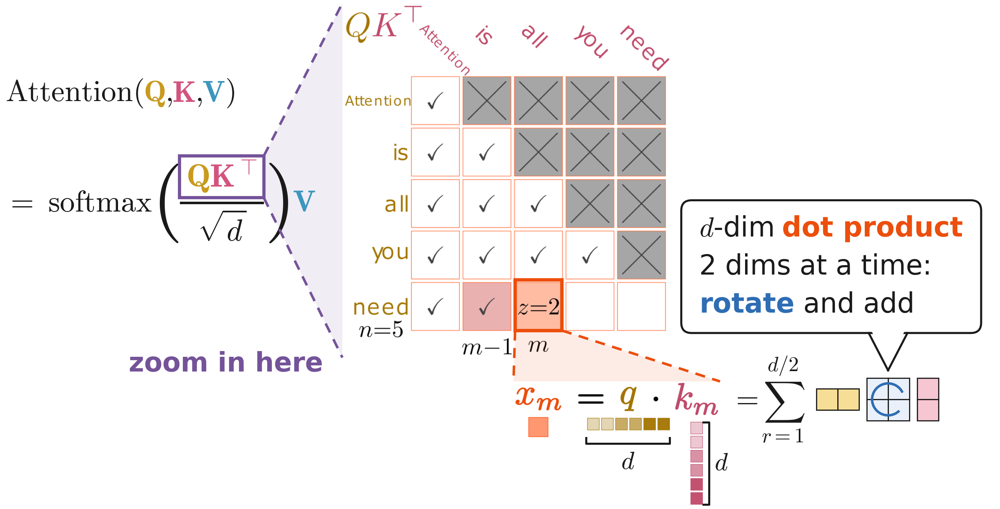
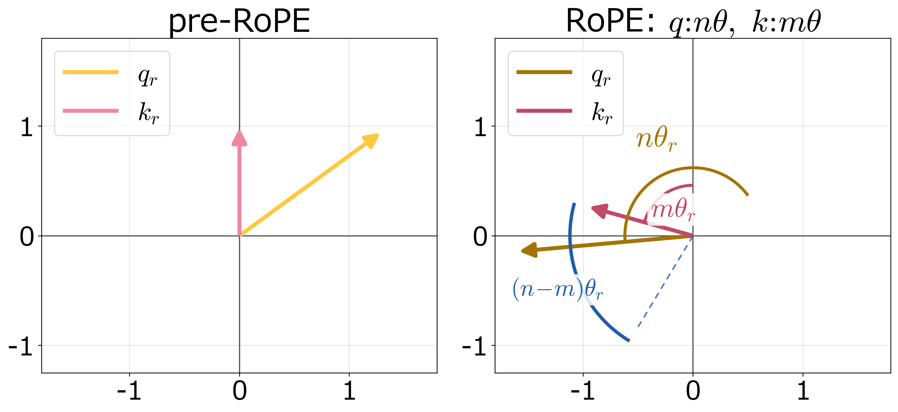
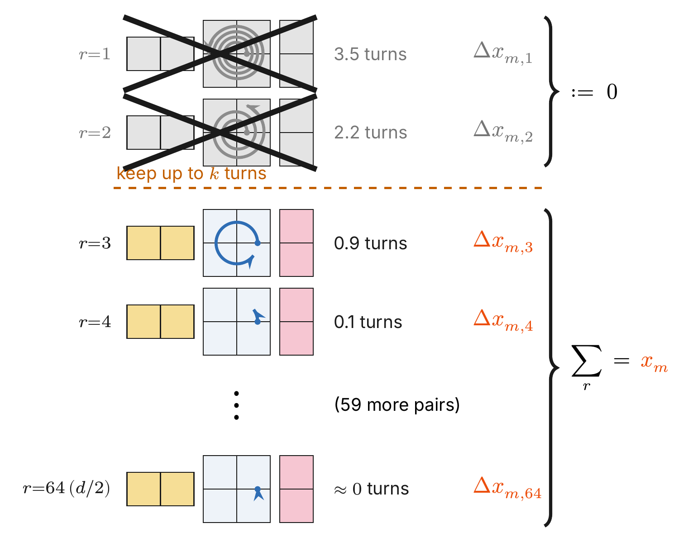
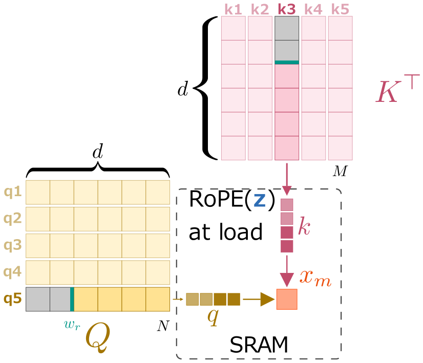
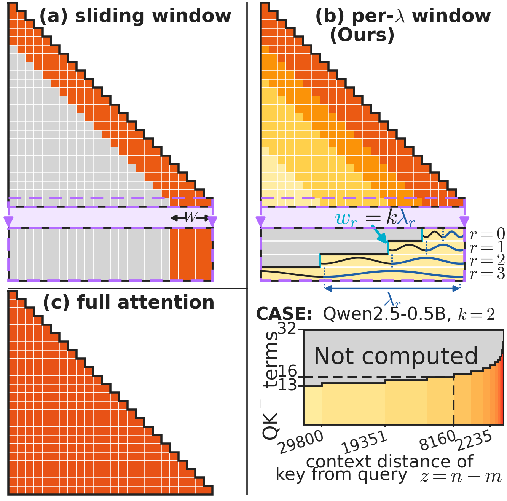
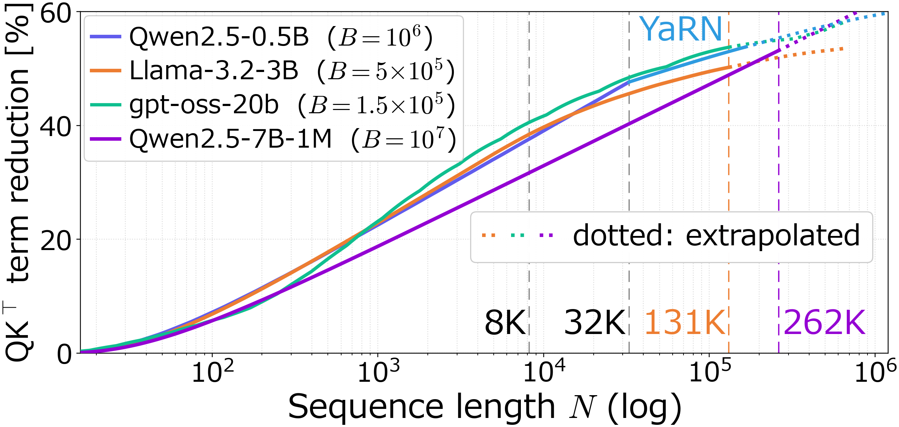
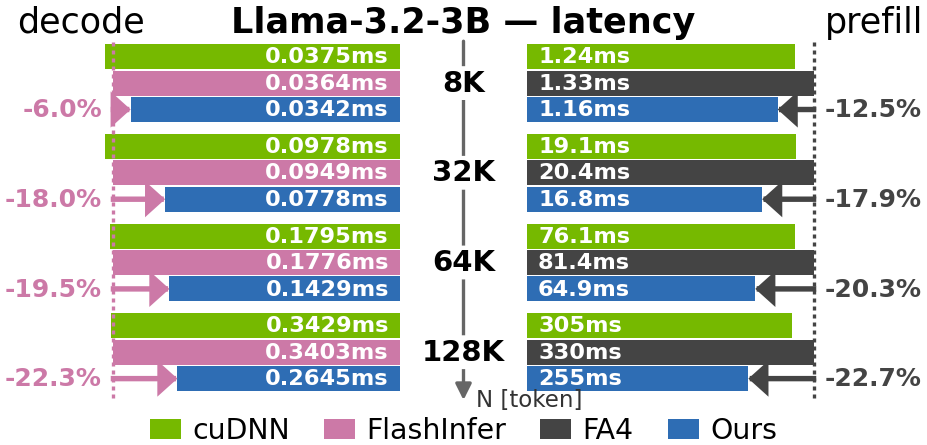
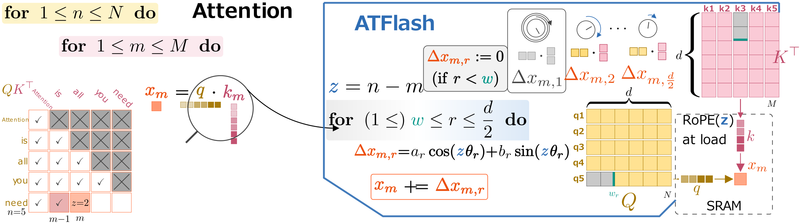
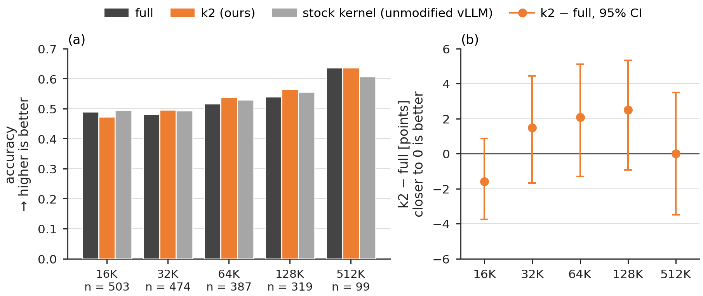

# ATFlash — Per-RoPE-Wavelength Attention Windows

Training-free, input-independent attention pruning for RoPE models, shipped as
**minimal diffs into released kernels**: FlashAttention-4 (prefill) and
FlashInfer (decode). With the window **off**, both ports are **bit-identical to
stock**. With the window **on**, on RTX PRO 6000 (Blackwell sm_120, GDDR7) both
ports outpace their stock implementations at every evaluated Llama context
length, and end to end the whole-request speedup reaches **`1.31×` at a 1M-token
context** (Qwen2.5-7B-Instruct-1M).

Paper: **[arXiv:2608.02947](https://arxiv.org/abs/2608.02947)** — *ATFlash:
Per-RoPE-Wavelength Attention Windows for Compute/Memory-Efficient LLM
Inference*.

## The idea

<p align="center"></p>

Zoom into one cell of the attention score matrix: it is a `d`-dimensional dot
product, and under RoPE it is computed two dimensions at a time — rotate the
pair, then add.

<p align="center"></p>

Rotary position embeddings rotate each 2D frequency pair of `q` and `k` by
`nθ_r` and `mθ_r`, so the pair's contribution to the score depends only on the
relative angle `(n−m)θ_r` — position enters the score exactly, pair by pair.

<p align="center"></p>

Over the same distance, how far each pair has rotated differs by orders of
magnitude — 3.5 full turns at the highest frequency shown, a fraction of a turn
at the lowest. Once a pair has completed `k` turns it can no longer
discriminate position at that distance, so ATFlash sets exactly those terms to
zero (gray: never computed, never loaded) and keeps the sum over the rest.

<p align="center"></p>

On the memory side this is a prefix rule: when a `q` row and a `K^T` column are
read for one cell, the gray out-of-window prefix is simply never read — the
rotation `RoPE(z)` is fused at load, and only the surviving dimensions enter
SRAM.

<p align="center"></p>

Seen over the whole causal triangle (panel (b) above; color depth = the number
of retained inner-product terms, and the lifted strip is the last query row
split by frequency pair), this is a distance window per pair: ATFlash prunes
the query–key inner-product terms of pair `r` beyond a wavelength-proportional
distance `w_r = k·λ_r`:

- **no token is dropped** — every key stays reachable through the low-frequency
  pairs, unlike a sliding window;
- **the reduction is input-independent**, with a closed form logarithmic in the
  sequence length `N` — you know the cost before running (`37–48%` of the terms
  within native context, deepening with `N`);
- **it is a slice of the query–key contraction axis** — the online-softmax
  recurrences (running max, normalizer, tiling) are untouched, which is why it
  ports into released kernels as a small diff, and why the out-of-window pair
  components are never even loaded into SRAM.

<p align="center"></p>

Vertical axis: share of QK^T inner-product terms pruned (higher = more compute
and K-traffic saved); dotted segments are extrapolated beyond each model's
verified range.

## Measured speed (RTX PRO 6000, 96 GB GDDR7)

<p align="center"></p>

- **Qwen2.5-7B-1M prefill:** the windowed kernel is the fastest of all four
  systems (stock FA4 / cuDNN / FlashInfer / ours) at every N from 8K to 512K
  (1.234× vs stock at 262K, 1.427× at 512K).
- **End to end** (FA4-port prefill feeding FlashInfer-port decode, one pipeline,
  window ON/OFF in the same binary): **`1.17×` / `1.22×` / `1.31×`** whole-request
  time at 256K / 512K / 1M tokens.
- **Wide window, still faster:** with `k = 64`, the setting that retrieves
  100/100 needles at 128K in [`evaluations/ruler_niah_128k/`](evaluations/ruler_niah_128k/),
  the whole request is **`1.09×`** faster at 256K and **`1.14×`** at 512K
  (Qwen2.5-7B-Instruct-1M, median of six rounds).
- **Bit-identity:** window OFF generates the same numerics as stock on both
  ports (`gates/`), so the ratio isolates the window itself. With the window on,
  both ports match an fp32 reference in `9/9` test cases each.

<details>
<summary>Numbers</summary>

- **Decode (FlashInfer 0.6.13 port, ~100 changed lines):** latency reductions of
  `6.0–22.3%` vs stock FlashInfer on Llama-3.2-3B at 8K–128K, growing with
  context; `1.296×` over stock at a 160K shape.
- **Prefill (FlashAttention-4 port, 4 files, +296/−13 lines):** `12.5–22.7%`
  faster than stock FA4 at 8K–128K, and below cuDNN at every context length.
- **Conditions** of the `k = 64` runs are in
  [`e2e_pipeline/`](e2e_pipeline/README.md#wide-window-end-to-end-measurements) and
  [`VERIFICATION.md`](VERIFICATION.md) (row 7a); the fp32 check is row 3.

Recovery of the theoretical `2/(1+s)` ceiling lines up across the two
implementation families (`85–96%`), so the conversion of predicted reduction into
wall-clock time is not implementation-specific.

</details>

## Using the ports

**FA4 prefill.** Public FA2–FA4 wheels do not support sm_120; build from the
companion repository
[`ATFlash-Kernel-FA4`](https://github.com/ATFlash/ATFlash-Kernel-FA4), which is
the upstream tree at the
pinned base with the window already applied (its `patches/` directory holds the
raw diffs and the ledger mapping each to its measured number). Requires
`nvidia-cutlass-dsl==4.2.0` and PyTorch ≥ 2.11. The window is opt-in through
the interface; without a window table the code path is stock.

**FlashInfer decode.** Start from the released FlashInfer 0.6.13 wheel, apply
`kernels/flashinfer_port/*.diff` as a shadow copy, and point `PYTHONPATH` +
`FLASHINFER_WORKSPACE_BASE` at it (`fiwin_common.py` shows the exact
mechanism). The window condition is added to the K-load predicate; window OFF
follows the stock code path.

**Window tables.** `window_tables/` generates the per-pair widths from the model
config (RoPE base, head dim, rope_scaling) — nothing is learned and nothing is
tuned per input. The tables used in the measurements are included verbatim.

**Verify first.** Run `gates/` against your build: window OFF must be
bit-identical to stock before any speed number is meaningful. That test is the
one we would ask of any new port, including our own.

<p align="center"></p>

<details>
<summary>Porting to something else</summary>

The two ports above are worked examples in two
unrelated kernel idioms — a CuTeDSL kernel and a CUDA-template kernel — which is
the evidence that the insertion is not tied to one codebase. For a third, you
need `atflash/window_table.py` to produce the per-pair widths, the prefix length
`D_eff` per key tile, and `atflash/reference.py` to check your output against.
One figure carries the whole picture — the nesting that makes the port small:
attention's two loops over query `n` and key `m`, and inside them the pair loop
over `r`, which is where ATFlash starts the reduction at the window boundary
`w`. Everything to the right of the arrow is the port; the memory side shows
the gray out-of-window prefix never entering SRAM, with `RoPE(z)` fused at
load.

(The full FlashAttention online-softmax loop with the same insertion marked —
including the running max, normalizer and PV accumulation — is in the
companion repository `ATFlash-Kernel-FA4`, next to the code it explains.)

</details>

## Scope and portability

Speed numbers above are measured on RTX PRO 6000 (sm_120, GDDR7), a
representative single-GPU inference platform outside the specialization
targets of FA3/FA4. The window itself is architecture-neutral (a static
shortening of the QK reduction);
ports to other kernels and other hardware generations are welcome.

Absolute paths in the harnesses (`/home/USER/...`) are placeholders standing in
for the machine the measurements ran on, and `agentA` / `agentB` are the tags of
the two measurement processes, kept because they are part of the run directory
names the raw summaries refer to. Point the paths at your own environment to
re-run.

## MiMo-V2.6-Pro-RL and MTP

On MiMo-V2.6-Pro-RL, a 1.02T-parameter MoE model with a native 1M context, LongBench-v2
accuracy with the window (`k = 2`) stays within `−1.59` to `+2.51` points of the
unwindowed model at 16K–128K, and the difference is `0.0` points at 512K
([`evaluations/mimo_v26_longbench_v2/`](evaluations/mimo_v26_longbench_v2/)).

<p align="center"></p>

The window also works with MiMo-V2.6-Pro-RL's multi-token prediction (MTP) head for
speculative decoding: with `k = 1–4`, how often an MTP draft matches the target
model stays within `0.5` points of full attention
([`evaluations/mimo_v26_mtp_compatibility/`](evaluations/mimo_v26_mtp_compatibility/)).

> [!TIP]
> **All results at a glance, each with its figure and a one-line takeaway:
> [`docs/overview.md`](docs/overview.md)** — kernel speed, and output quality
> from 0.5B to 70B and on MiniMax-M2.7.

## License

Apache-2.0 throughout (`LICENSE`, `NOTICE`). The only third-party-derived
files here are `kernels/flashinfer_port/*.diff`, from FlashInfer — itself
Apache-2.0; its license and NOTICE are carried under `third_party/`. All
FlashAttention-derived material (BSD-3-Clause) lives in `ATFlash-Kernel-FA4`.
Details in `THIRD_PARTY_NOTICES.md`. Neither upstream project is affiliated
with or endorses these modifications.

## Citation

```bibtex
@misc{hayashi2026atflash,
  title         = {ATFlash: Per-RoPE-Wavelength Attention Windows for
                   Compute/Memory-Efficient LLM Inference},
  author        = {Hayashi, Shun{-}ichiro and Mukunoki, Daichi and
                   Hoshino, Tetsuya and Katagiri, Takahiro},
  year          = {2026},
  eprint        = {2608.02947},
  archivePrefix = {arXiv},
  primaryClass  = {cs.LG}
}
```
