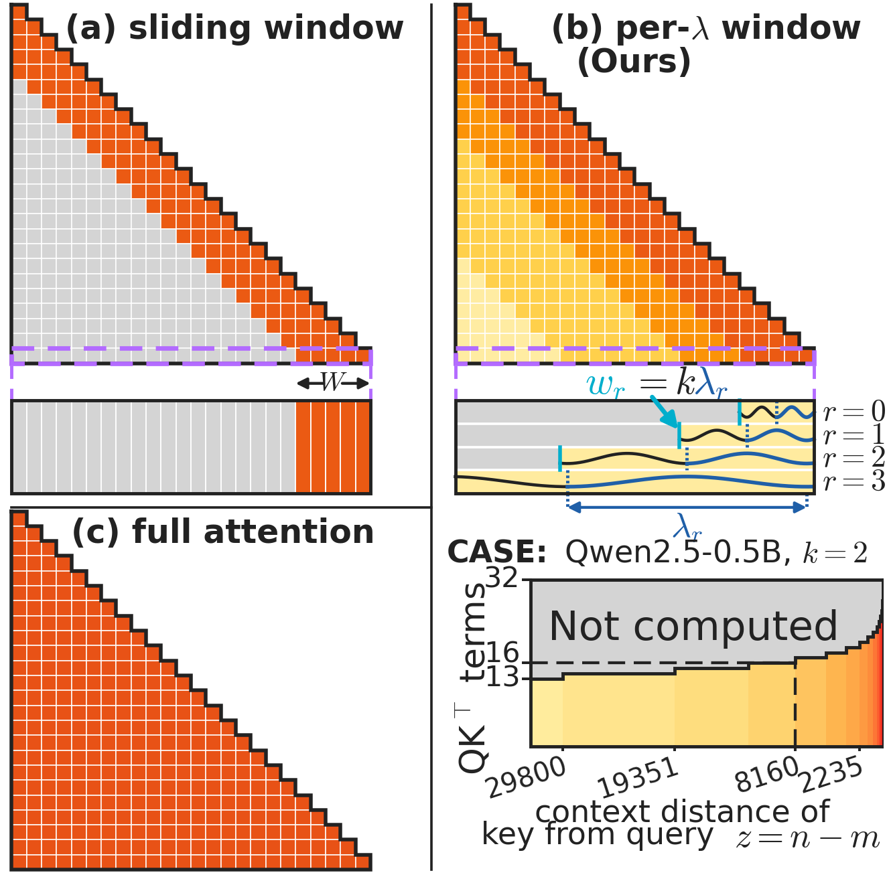

# ATFlash — Per-RoPE-Wavelength Attention Windows

Training-free, input-independent attention pruning for RoPE models, shipped as
**minimal diffs into released kernels**: FlashAttention-4 (prefill) and
FlashInfer (decode). With the window **off**, both ports are **bit-identical to
stock**. With the window **on**, on RTX PRO 6000 (Blackwell sm_120, GDDR7) both
ports outpace their stock implementations at every evaluated Llama context
length, and end to end the whole-request speedup reaches **1.31× at a 1M-token
context** (Qwen2.5-7B-Instruct-1M).

Paper: **[arXiv:2608.02947](https://arxiv.org/abs/2608.02947)** — *ATFlash:
Per-RoPE-Wavelength Attention Windows for Compute/Memory-Efficient LLM
Inference*. Section references (§) below follow the paper.

## The idea

<p align="center"></p>

The attention score under rotary position embeddings decomposes **exactly** into
a sum over its 2D-rotation frequency pairs, and each pair's wavelength
`λ_r = 2π/θ_r` bounds how far that pair can discriminate position. ATFlash
prunes the query–key inner-product terms of pair `r` beyond a
wavelength-proportional distance `w_r = k·λ_r`:

- **no token is dropped** — every key stays reachable through the low-frequency
  pairs, unlike a sliding window;
- **the reduction is input-independent**, with a closed form logarithmic in the
  sequence length `N` — you know the cost before running (37–48% of the terms
  within native context, deepening with `N`);
- **it is a slice of the query–key contraction axis** — the online-softmax
  recurrences (running max, normalizer, tiling) are untouched, which is why it
  ports into released kernels as a small diff, and why the out-of-window pair
  components are never even loaded into SRAM.

<p align="center"></p>

## Measured speed (RTX PRO 6000, 96 GB GDDR7)

<p align="center"></p>

- **Decode (FlashInfer 0.6.13 port, ~100 changed lines):** latency reductions of
  6.0–22.3% vs stock FlashInfer on Llama-3.2-3B at 8K–128K, growing with
  context; 1.296× over stock at a 160K shape.
- **Prefill (FlashAttention-4 port, 4 files, +296/−13 lines):** 12.5–22.7%
  faster than stock FA4 at 8K–128K, and below cuDNN at every context length.
- **Qwen2.5-7B-1M prefill:** the windowed kernel is the fastest of all four
  systems (stock FA4 / cuDNN / FlashInfer / ours) at every N from 8K to 512K
  (1.234× vs stock at 262K, 1.427× at 512K).
- **End to end** (FA4-port prefill feeding FlashInfer-port decode, one pipeline,
  window ON/OFF in the same binary): **1.17× / 1.22× / 1.31×** whole-request
  time at 256K / 512K / 1M tokens.
- **Bit-identity:** window OFF generates the same numerics as stock on both
  ports (`gates/`), so the ratio isolates the window itself.

Recovery of the theoretical `2/(1+s)` ceiling lines up across the two
implementation families (85–96%), so the conversion of predicted reduction into
wall-clock time is not implementation-specific.

Output quality is evaluated in the paper (§6): top-1 match 96–98% and KL at the
1e-3-nat level in the native regime, benchmark scores broadly preserved, with
one identified exception (retrieval over structureless strings) that the single
parameter `k` recovers — `k` is a deployment-time dial between attention
accuracy and compute.

## Repository layout

| dir | contents |
|---|---|
| `atflash/` | The method itself: the window rule (`window_table.py`) and a readable torch reference (`reference.py`). Start here. |
| `kernels/fa4_port/` | The FA4 prefill window as patches against upstream commit `5835c73`, plus the patched CuTe interface. |
| `kernels/flashinfer_port/` | The FlashInfer 0.6.13 decode window as unified diffs, plus the JIT/shadow-copy helper. |
| `window_tables/` | The torch-free table generator, and the exact per-model tables used in every run. |
| `gates/` | Bit-identity and neutrality gates (window OFF == stock; chunked == single-shot). |
| `microbench/` | The prefill microbenchmark and the raw measurements behind the latency figure above. |
| `e2e_pipeline/` | The end-to-end 1M-context harness (FA4 prefill + FlashInfer decode inside HF transformers). |
| `results_raw/` | Raw run summaries behind the speed tables. |

Each directory carries its own `README.md` with file-by-file roles.
**`VERIFICATION.md` records what was actually measured, on what hardware, and —
just as importantly — what was not.**

## Using the ports

**FA4 prefill.** Public FA2–FA4 wheels do not support sm_120; build
FlashAttention-4 from source at upstream commit `5835c73`, then apply
`kernels/fa4_port/fa4_full_window_HEAD.patch` (or the prefill-only variants —
see `FA4_PATCH_RECONCILIATION.md` for which patch corresponds to which measured
number). Requires `nvidia-cutlass-dsl==4.2.0` and PyTorch ≥ 2.11. The window is
opt-in through the interface; without a window table the code path is stock.

**FlashInfer decode.** Start from the released FlashInfer 0.6.13 wheel, apply
`kernels/flashinfer_port/*.diff` as a shadow copy, and point `PYTHONPATH` +
`FLASHINFER_WORKSPACE_BASE` at it (`fi_window_helpers.py` shows the exact
mechanism). The window condition is added to the K-load predicate; window OFF
follows the stock code path.

**Window tables.** `window_tables/` generates the per-pair widths from the model
config (RoPE base, head dim, rope_scaling) — nothing is learned and nothing is
tuned per input. The tables used in the measurements are included verbatim.

**Verify first.** Run `gates/` against your build: window OFF must be
bit-identical to stock before any speed number is meaningful. That test is the
one we would ask of any new port, including our own.

**Porting to something else.** The two ports above are worked examples in two
unrelated kernel idioms — a CuTeDSL kernel and a CUDA-template kernel — which is
the evidence that the insertion is not tied to one codebase. For a third, you
need `atflash/window_table.py` to produce the per-pair widths, the prefix length
`D_eff` per key tile, and `atflash/reference.py` to check your output against.

## Scope and portability

Speed numbers above are from a single hardware generation (sm_120, GDDR7) —
a representative single-GPU inference platform outside the specialization
targets of FA3/FA4 — and the paper reports them as such (§8, Limitations). The
window itself is architecture-neutral (a static shortening of the QK reduction);
ports to other kernels and other hardware generations are welcome.

Absolute paths in the harnesses (`/home/USER/...`) are placeholders standing in
for the machine the measurements ran on, and `agentA` / `agentB` are the tags of
the two measurement processes, kept because they are part of the run directory
names the raw summaries refer to. Point the paths at your own environment to
re-run.

## License

Apache-2.0 (`LICENSE`, `NOTICE`).

Two parts are derived from other projects and keep their original licenses:
`kernels/fa4_port/` from FlashAttention (BSD-3-Clause) and
`kernels/flashinfer_port/*.diff` from FlashInfer (Apache-2.0). Full texts are
under `third_party/`; the file-by-file breakdown is in
`THIRD_PARTY_NOTICES.md`. Neither upstream project is affiliated with or
endorses these modifications.

## Citation

```bibtex
@misc{hayashi2026atflash,
  title         = {ATFlash: Per-RoPE-Wavelength Attention Windows for
                   Compute/Memory-Efficient LLM Inference},
  author        = {Hayashi, Shun-ichiro and Mukunoki, Daichi and
                   Hoshino, Tetsuya and Katagiri, Takahiro},
  year          = {2026},
  eprint        = {2608.02947},
  archivePrefix = {arXiv},
  primaryClass  = {cs.LG}
}
```
