# Results at a glance

Every figure of this repository with a one-line takeaway and the page that
holds its conditions and data. The numbers are copied from those pages; nothing
here is new. Terms are defined in [`glossary.md`](glossary.md).

## How the window works

| figure | takeaway |
|---|---|
| 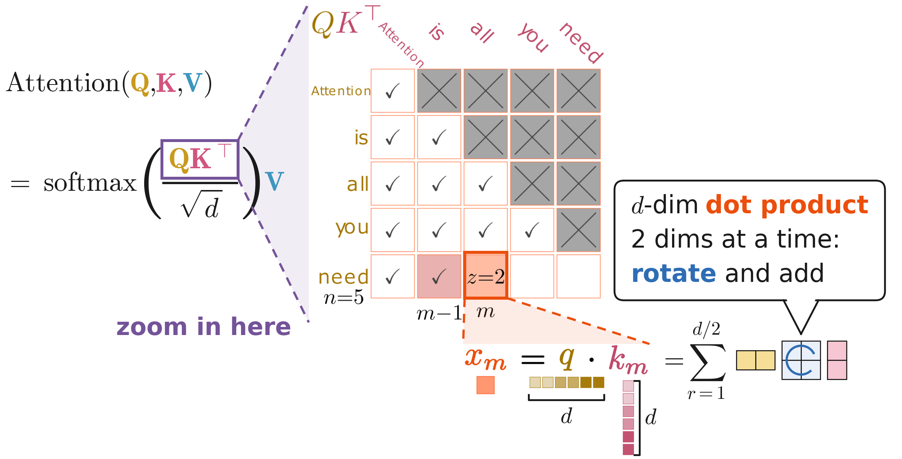 | One attention score is a `d`-dimensional dot product, and under RoPE it is computed two dimensions at a time. |
| 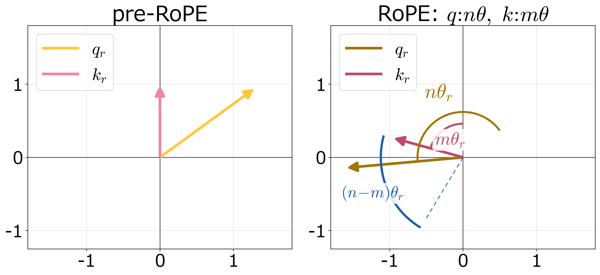 | Each pair's contribution depends only on the relative angle `(n−m)θ_r`. |
| 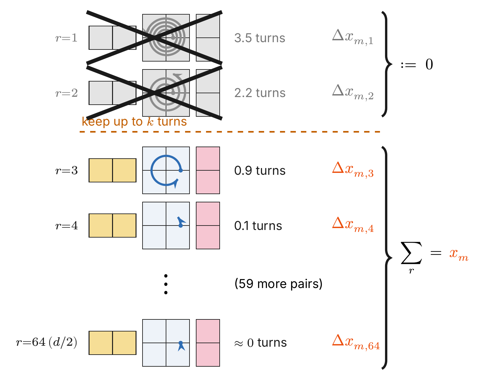 | Over the same distance, pairs rotate by amounts that differ by orders of magnitude; once a pair has completed `k` turns its terms are pruned. |
| 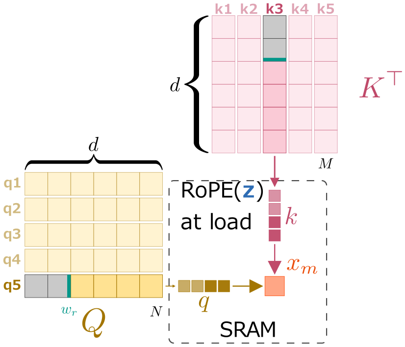 | The out-of-window prefix of `q` and `K^T` is never read into SRAM. |
| 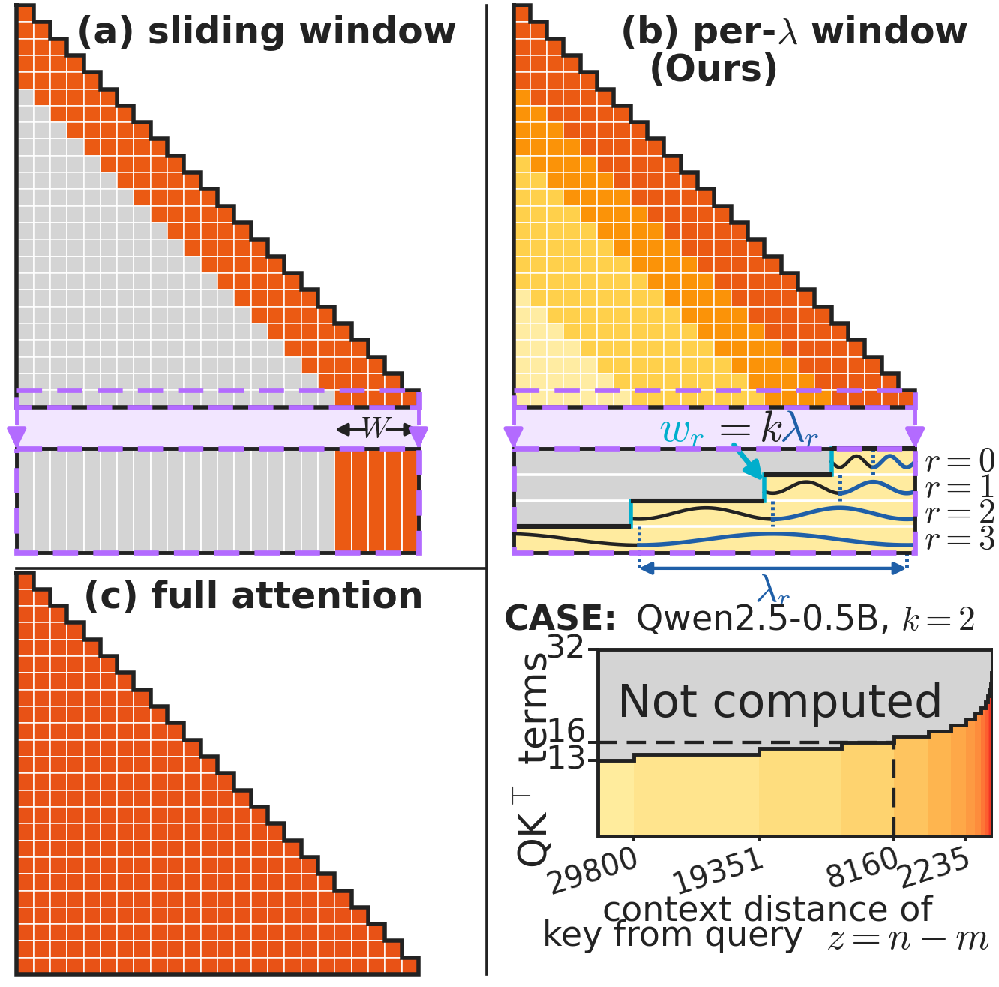 | Over the causal triangle this is a distance window per pair: no token is dropped, every key stays reachable through the low-frequency pairs. |
| 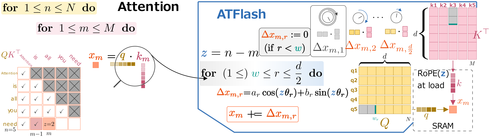 | The port starts the pair loop at the window boundary inside attention's two loops, which is why it is a small diff. |

## Cost

| figure | takeaway | details |
|---|---|---|
| 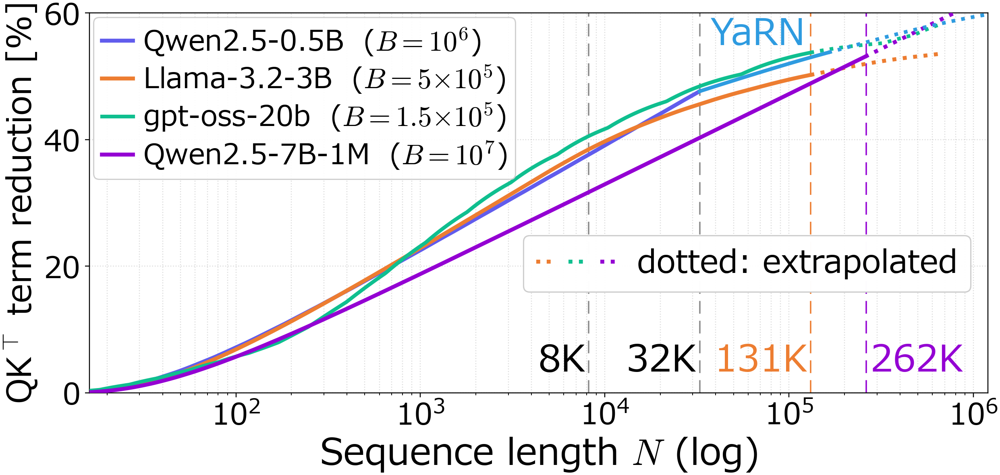 | The share of QK terms pruned is input-independent and logarithmic in `N`: `37–48%` of the terms within native context. | [README](../README.md#the-idea) |
| 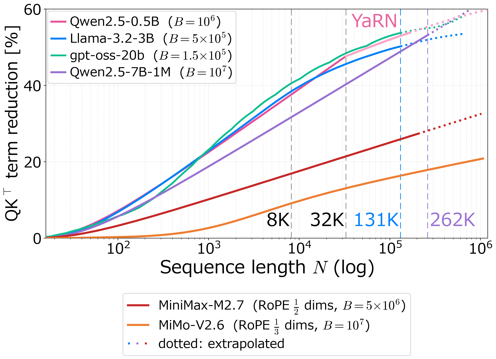 | In partial-RoPE models the same closed form is scaled by the rotary fraction: MiniMax-M2.7 removes `27.35%` of the terms at its native 204,800 tokens. | [`evaluations/partial_rope_qk_closed_form/`](../evaluations/partial_rope_qk_closed_form/) |

## Speed (RTX PRO 6000, sm_120)

| figure | takeaway | details |
|---|---|---|
| 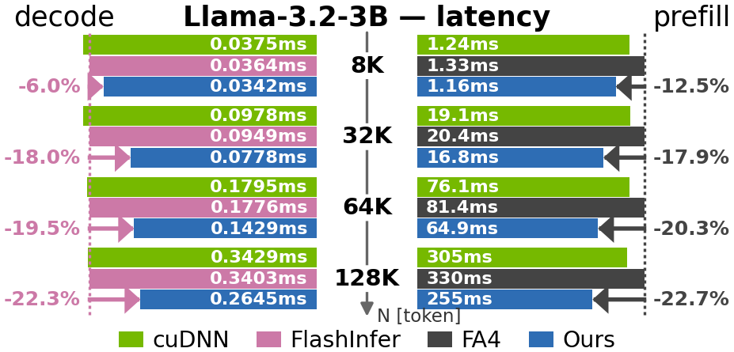 | Llama-3.2-3B at 8K–128K: decode latency `6.0–22.3%` below stock FlashInfer, prefill `12.5–22.7%` faster than stock FA4. | [README](../README.md#measured-speed-rtx-pro-6000-96-gb-gddr7), [`microbench/`](../microbench/) |

End to end (FA4-port prefill feeding FlashInfer-port decode, window ON/OFF in
the same binary), the whole-request time improves by **`1.17×` / `1.22×` / `1.31×`**
at 256K / 512K / 1M tokens on Qwen2.5-7B-Instruct-1M
([`e2e_pipeline/`](../e2e_pipeline/), [`results_raw/`](../results_raw/)). With
the window off, both ports are bit-identical to stock ([`gates/`](../gates/)).

## Output quality

<table>
<tr><th colspan="2">tags</th><th>item</th><th>figure</th><th>takeaway</th></tr>
<tr><td rowspan="2" colspan="2" align="center"><b>window analysis</b></td><td><a href="../evaluations/window_assignment/">vs random window</a></td><td>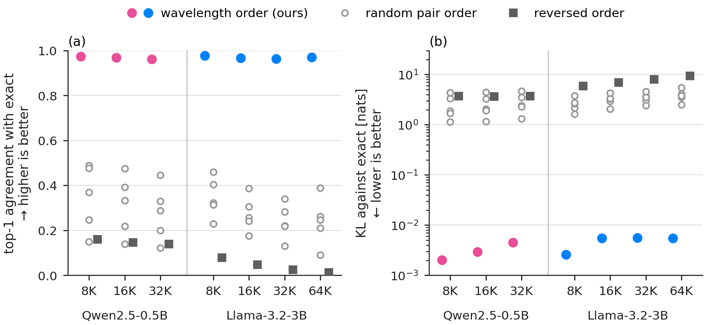</td><td>It is the wavelength assignment that matters: with the kept count fixed at every distance, top-1 is <code>0.962–0.978</code> for the rule, 0.013–0.160 reversed and 0.090–0.489 random.</td></tr>
<tr><td><a href="../evaluations/dropped_vs_kept_terms/">dropped-term magnitude</a></td><td>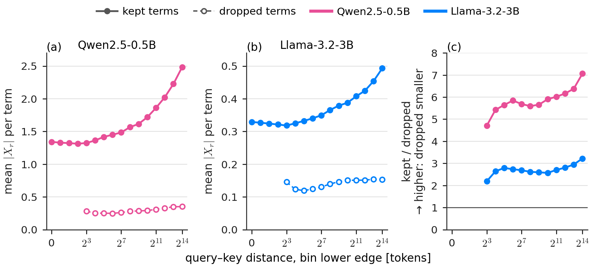</td><td>The removed terms are <code>2.2–7.1×</code> smaller than the kept ones, in all 12 distance bins of both models that contain removed terms.</td></tr>
<tr><td colspan="2" align="center"><b>model scaling</b></td><td><a href="../evaluations/model_scale/">7B–70B fidelity</a></td><td>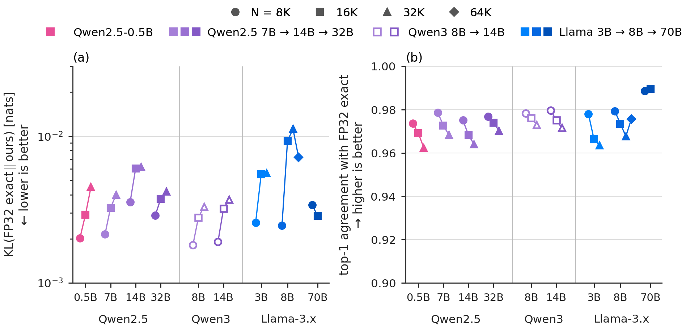</td><td>Qwen2.5-7B/14B/32B, Qwen3-8B/14B and Llama-3.1-8B/70B: top-1 <code>0.9640–0.9896</code>, mean KL <code>0.00181–0.01122</code> nats, |ΔPPL| ≤ <code>0.21%</code>.</td></tr>
<tr><td rowspan="3"><b>MoE  NoPE</b></td><td><b>MTP</b></td><td><a href="../evaluations/mimo_v26_mtp_compatibility/">MTP</a></td><td>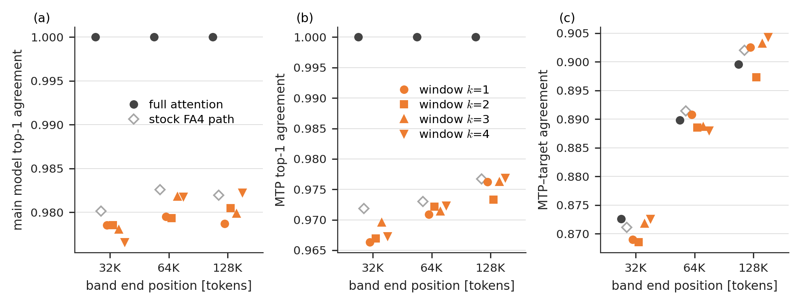</td><td>MiMo-V2.6 with its bundled MTP head at 32K–128K: with the window (<code>k = 1–4</code>) MTP top-1 agreement is <code>0.966–0.977</code> (stock FA4 kernel 0.972–0.977), and the MTP–target agreement stays within <code>0.5</code> points of full attention.</td></tr>
<tr><td rowspan="3"><b>long context</b></td><td><a href="../evaluations/mimo_v26_longbench_v2/">LongBench-v2</a> 16K–512K</td><td>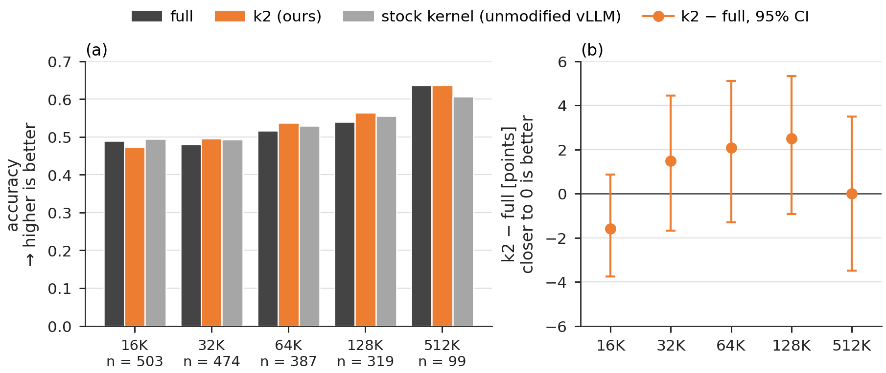</td><td>MiMo-V2.6 on LongBench-v2: within <code>−1.59</code> to <code>+2.51</code> points of the unwindowed model over all 503 items at 16K–128K, and <code>0.0</code> points at 512K inside its native 1M context (99 items); every 95% interval includes 0.</td></tr>
<tr><td><a href="../evaluations/partial_rope/">vs NoPE window</a> (<a href="../evaluations/minimax_m27_partial_rope/">MiniMax-M2.7</a>)</td><td>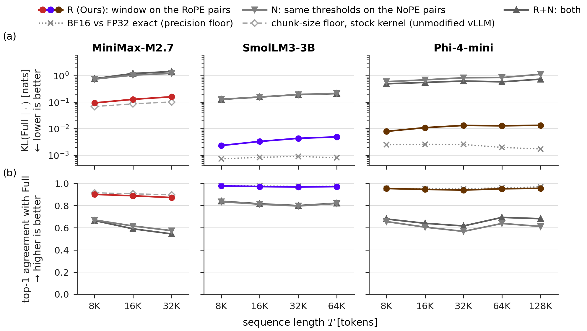</td><td>With the window on the rotary part, top-1 stays at <code>0.87–0.98</code> in three partial-RoPE models; removing as many terms from the non-rotary part drops it to 0.57–0.84, and MiniMax-M2.7 then solves 0/100 RULER needles at 16K, against <code>100/100</code> with the window.</td></tr>
<tr><td rowspan="2"></td><td><a href="../evaluations/ruler_niah_128k/">needles at 128K</a></td><td>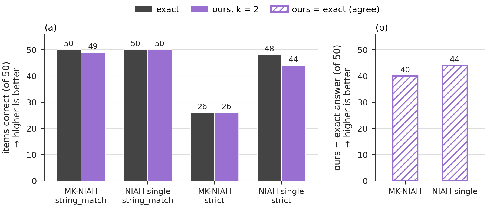</td><td>A single needle at about 131K tokens: <code>99/100</code> with the window (<code>k = 2</code>), <code>100/100</code> with <code>k = 64</code> and 100/100 exact, under RULER's <code>string_match</code> (teacher-forced answers).</td></tr>
<tr><td></td><td>all models <a href="../evaluations/">evaluation list</a></td><td>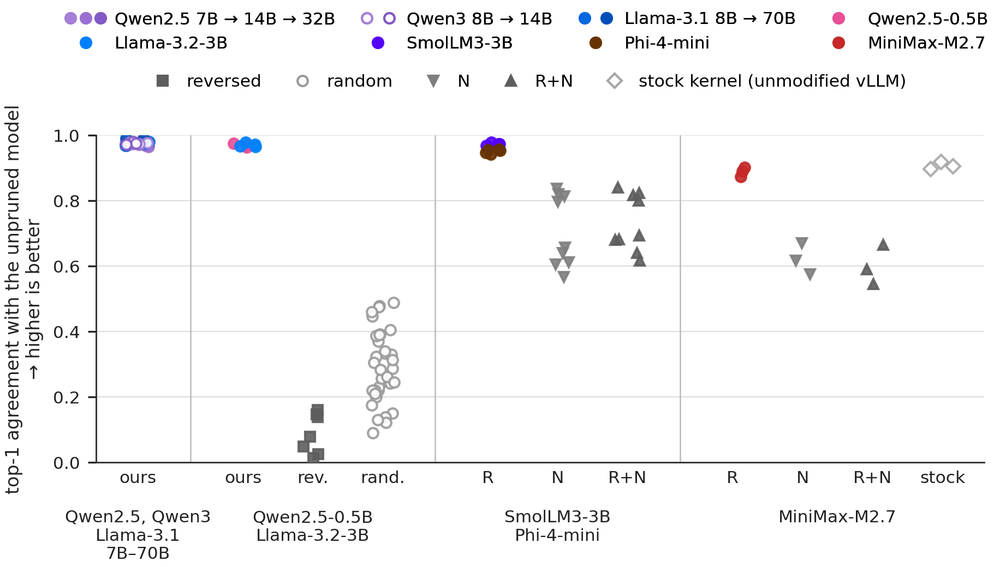</td><td>Every model of the four fidelity studies on one axis: top-1 agreement with the unpruned model for the window on rotary pairs (<code>k = 2</code>), in the colour of each model, next to the grey random and NoPE controls.</td></tr>
</table>
