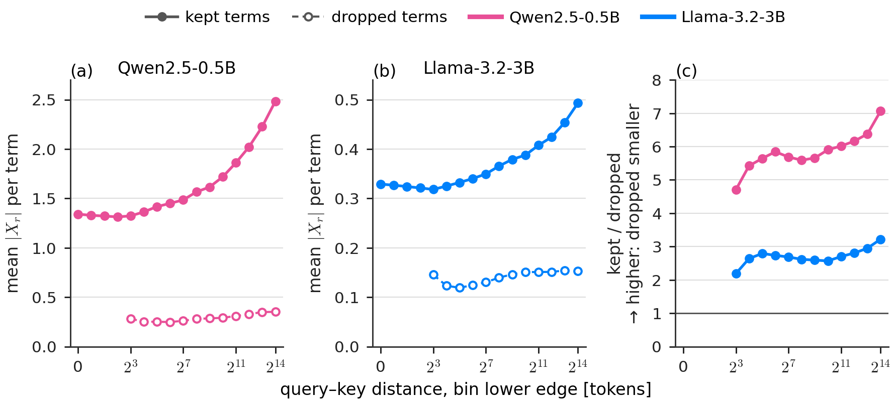

# How large the removed terms are

**Result.** The query–key terms the window removes are small: on real rotated `q`, `k` from Qwen2.5-0.5B and Llama-3.2-3B at 32K tokens, a removed term is on average 2.2–7.1× smaller than a kept term at the same distance, in all 12 distance bins of both models that contain removed terms.

Mean magnitude of the kept and dropped QK terms by query–key distance (Qwen2.5-0.5B and Llama-3.2-3B, k = 2; pink and blue). Solid, filled: kept; dashed, open: dropped; right: their ratio. In every distance bin the dropped terms are 2.2–7.1× smaller than the kept ones.

Setup

- **Term:** for a query at position `n`, a key at `m`, distance `z = n − m`, and pair `r` (dimensions `r` and `r + d/2` in the model's rotate-half layout),

      X_r(n, m) = (q_r[n]·k_r[m] + q_{r+d/2}[n]·k_{r+d/2}[m]) / sqrt(d)

  with the rotated `q`, `k` exactly as the model computes them. The `X_r` sum to the full scaled logit (the decomposition is checked per layer). The window removes `X_r(n, m)` when `w_r < z`, with `w_r = min(2·λ_r, N)`.
- **Measured on** the exact (unwindowed) forward pass, so the values are the sizes of the terms the window would remove from that trajectory.
- **Models:** `Qwen/Qwen2.5-0.5B` (revision `060db6499f32faf8b98477b0a26969ef7d8b9987`) and `unsloth/Llama-3.2-3B` (revision `d4446454d87d51aa42e1fb174f25acc5f8762331`).
- **Tokens:** the first 32,768 tokens of the LongBench-v2 text of `../model_scale/` (token-id SHA-256 `73a3f779…` for Qwen, `1116af9c…` for Llama, the same as the 32K rows there).
- **Sampled cells:** the last 256 query rows against every causal key (these rows cover every distance from 0 to 32,767), all layers, all heads, all pairs. Window `k = 2`.
- **Arithmetic and hardware:** fp32 weights and activations; PyTorch 2.11.0+cu130 with its default fp32 matmul precision; NVIDIA H100 (95,830 MiB), driver 615.71.09. A second run on an RTX PRO 6000 with TF32 explicitly disabled and recorded in-process reproduces every bin mean to within 2·10⁻⁷ relative.

Numbers

Mean `|X_r|` in logit units, pooled over all layers, heads and pairs in the bin. Below distance 8 nothing is removed (the shortest window is longer than 8).

Files

| file | contents |
|---|---|
| `results.csv` | One row per (model, distance bin): revision, bin edges, removed and kept term counts, mean `|X_r|` of each, and their ratio. |

