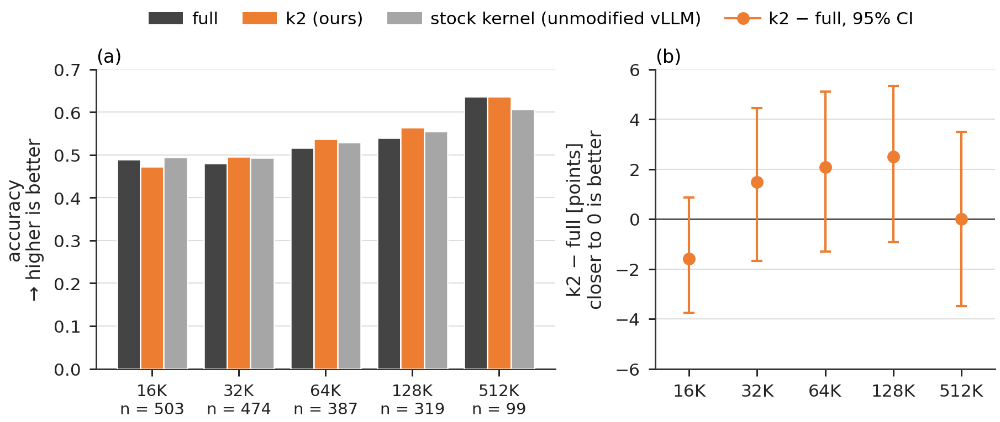

# MiMo-V2.6: LongBench-v2 from 16K to 512K

**Result.** With the window (k = 2) on the 64 rotary of the 192 query/key dimensions in MiMo-V2.6-Pro-RL's 10 full-attention layers, LongBench-v2 accuracy stays within −1.59 to +2.51 points of the same model without the window over all 503 items at 16K–128K, and at 512K, inside the model's native 1M context, the difference is 0.0 points (99 items, paired 95% CI −3.5 to +3.5); every 95% interval includes 0. At 16K–128K the window removes 12.2–16.4% of the query–key terms of these layers (36.6–49.3% of their rotary terms).

MiMo-V2.6-Pro-RL on LongBench-v2 in five context bands (16K–128K: every item; 512K: every item with at least 262,144 tokens). Left: accuracy of full (our path without the window), k2 (ours) and the stock kernel (unmodified vLLM; "stock" below); right: k2 − full in points with 95% intervals. Every interval includes 0.

In the 16K–128K bands, swapping only the attention implementation (stock), with no window at all, already changes 10–11% of the chosen answers. Position by position, the window's KL is 1.1–1.3× that of the stock kernel, and the context PPL moves by less than 0.002.

Setup

- **Model:** MiMo-V2.6-Pro-RL, the released quantized checkpoint as served: FP8 E4M3 (128-blocks) and MXFP4 weights, BF16 activations between layers, MoE experts with MXFP8 activations × MXFP4 weights, router gate with BF16 input and FP32 output, FP32 accumulation inside kernels, BF16 KV cache. Native context 1,048,576 tokens.
- **Window:** `w_r = k·λ_r` on the 64 rotary dimensions (RoPE base 10⁷) of the 10 full-attention layers. The 128 dimensions without rotation, the 60 sliding-window layers and the model's speculative-decoding heads are untouched. Window attention: QK with BF16 inputs and FP32 accumulation, PV in FP32 (TF32 off).
- **Arms:** **full**, the same PyTorch attention path without the window; **k2**, the window with k = 2; **stock**, vLLM's own attention kernel (FA4), which shows the size of an implementation change. k = 1, 1.5, 3, 4 on a 50-item subset of each 16K–128K band; a repeated full run and a full run with 8,192-token chunks on 5 items per band. All arms use the same precision.
- **Serving:** a vLLM integration that will be released separately, with the window in an eager PyTorch attention path; vLLM 0.29.1rc1 on one node with four NVIDIA B200 GPUs (GB200 NVL4), tensor/expert parallel 4, eager mode, batch 1, prefill chunk 16,384, no prefix cache. Final logits recomputed in FP64.
- **Items:**
  - 16K–128K: LongBench-v2, every item. Band N holds every item whose context has at least N/2 tokens, truncated to N − 512 tokens keeping the end: 319 (128K), 387 (64K), 474 (32K), 503 (16K) items, 503 distinct.
  - 512K: every LongBench-v2 item whose full text has at least 262,144 tokens (99 items), with prompts of 271,101–524,846 tokens. It is the longest band measured so far; the native context is 1,048,576 tokens.
  - The same item can appear in several bands, so no cross-band sum or test is reported.
- **Scoring:** the answer is the argmax of the log-probabilities of the letters A–D (log-probability scoring, not generation), the same rule in every band. Paired comparisons use the exact two-sided McNemar test; the interval is the Clopper–Pearson 95% interval conditional on the discordant pairs, mapped to the difference.
- **Position-wise fidelity (16K–128K):** `KL(P_full ‖ P_condition)`, averaged within each item and then over items. Tail = the last 1,024 positions; every 8th = positions 0, 8, 16, … before the tail. PPL is taken on the true next tokens of the tail, split into context and footer (question and choices); two items whose footers are longer than 1,024 tokens have no context tokens in the tail and are left out of the context PPL in every band.
- **Verification:** every reported 16K–128K cell was recomputed independently from the raw records (412 answer cells, 120 position cells; no disagreement). The 512K values were recomputed from the 307 per-question records with an independent scorer; all match.

Numbers

Paired comparisons (`b`: items only the left arm answers correctly; `c`: items only the right arm answers correctly):

| band | left vs right | same choice | b | c | p | difference (points) | 95% interval (points) |
|---|---|---:|---:|---:|---:|---:|---:|
| 512K | k2 vs full | 0.929 | 2 | 2 | 1.000 | 0.00 | −3.49 to +3.49 |
| 512K | k2 vs stock | 0.889 | 5 | 2 | 0.453 | +3.03 | −2.96 to +6.55 |
| 512K | full vs stock | 0.919 | 4 | 1 | 0.375 | +3.03 | −2.19 to +5.00 |
| 128K | k2 vs full | 0.897 | 17 | 9 | 0.169 | +2.51 | −0.92 to +5.34 |
| 128K | k2 vs stock | 0.884 | 14 | 11 | 0.690 | +0.94 | −2.36 to +4.01 |
| 128K | full vs stock | 0.897 | 10 | 15 | 0.424 | −1.57 | −4.53 to +1.78 |
| 64K | k2 vs full | 0.837 | 23 | 15 | 0.256 | +2.07 | −1.30 to +5.10 |
| 64K | k2 vs stock | 0.881 | 18 | 15 | 0.728 | +0.78 | −2.33 to +3.73 |
| 64K | full vs stock | 0.889 | 12 | 17 | 0.458 | −1.29 | −3.97 to +1.66 |
| 32K | k2 vs full | 0.876 | 29 | 22 | 0.401 | +1.48 | −1.67 to +4.44 |
| 32K | k2 vs stock | 0.882 | 22 | 21 | 1.000 | +0.21 | −2.64 to +3.03 |
| 32K | full vs stock | 0.892 | 15 | 21 | 0.405 | −1.27 | −3.72 to +1.40 |
| 16K | k2 vs full | 0.891 | 13 | 21 | 0.229 | −1.59 | −3.76 to +0.87 |
| 16K | k2 vs stock | 0.889 | 14 | 25 | 0.108 | −2.19 | −4.47 to +0.44 |
| 16K | full vs stock | 0.903 | 17 | 20 | 0.743 | −0.60 | −3.02 to +1.92 |

- At 16K–128K the sign of k2 − full is positive in three bands and negative in one; in every band the difference is smaller than the interval's width, and the smallest p-value among the 12 paired comparisons is 0.108. At 512K, k2 − full is 0.0 points (b = c = 2).

Position-wise fidelity and PPL (16K–128K):

| band | tail KL, k2 | tail KL, stock | every-8th KL, k2 | every-8th KL, stock | context PPL full / k2 / stock | footer PPL full / k2 / stock |
|---|---:|---:|---:|---:|---|---|
| 128K | 1.115e-2 | 8.538e-3 | 8.856e-3 | 7.574e-3 | 2.0843 / 2.0853 / 2.0838 | 5.0489 / 5.0642 / 5.0485 |
| 64K | 1.068e-2 | 8.647e-3 | 8.741e-3 | 7.716e-3 | 2.1348 / 2.1349 / 2.1348 | 5.1928 / 5.1941 / 5.1881 |
| 32K | 9.889e-3 | 8.539e-3 | 8.714e-3 | 7.906e-3 | 2.1540 / 2.1541 / 2.1536 | 5.3605 / 5.3680 / 5.3646 |
| 16K | 9.713e-3 | 8.689e-3 | 8.933e-3 | 8.308e-3 | 2.2538 / 2.2524 / 2.2531 | 5.5870 / 5.5818 / 5.5897 |

- **Other values of k:** on a fixed subset of 50 items per band (the first 50 by id), the tail KL decreases with k in every band: for example at 128K, 1.303e-2 (k = 1), 1.276e-2 (1.5), 1.225e-2 (3), 1.211e-2 (4). Correct answers on the subset are 25 / 28 / 28 / 28 (128K), 28 / 29 / 29 / 31 (64K), 30 / 30 / 30 / 28 (32K) and 29 / 32 / 31 / 29 (16K) for k = 1 / 1.5 / 3 / 4.
- **Repeatability and chunk size:** a repeated full run (5 items per band) gives identical choices in every band, and zero KL at every position at 16K–128K. Changing the prefill chunk from 16,384 to 8,192 (5 items per band) changes one choice at 32K and one at 512K; at 16K–128K it gives a tail KL of 8.5e-3–8.8e-3, the same size as the stock difference.

Files

| file | contents |
|---|---|
| `results.csv` | Per (band, arm): items, correct answers, accuracy (all arms, including the k subset, the repeated run and the chunk-size run; 512K rows first). |
| `results_paired.csv` | Per (band, arm, reference): pairs, same-choice rate, b, c, exact McNemar p, difference and interval in points, and KL / top-1 / top-20 overlap at the answer position (the last three are 16K–128K only). |
| `results_position_fidelity.csv` | Per (band, arm), 16K–128K: tail and every-8th KL against full, and tail context / footer PPL with their item and token counts. |
| `results_pruned_share.csv` | Per (band, k), 16K–128K: removed products, causal pairs, the two denominators (× 192 and × 64), the shares, and the per-item range. |
| `make_fig_mimo_longbench_v2.py` | Draws `../../figs/mimo_longbench_v2_512k.png` from `results.csv` and `results_paired.csv`; with `--bands 4` it draws the 16K–128K version (`mimo_longbench_v2.png`, not included). |

