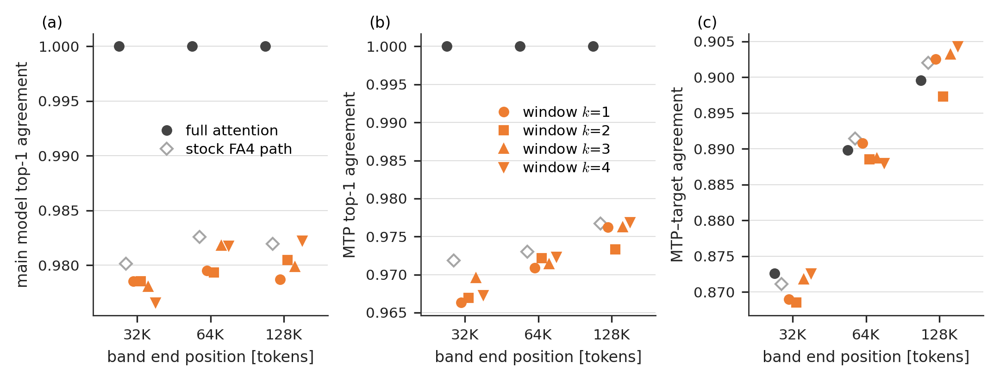

# MTP compatibility of the RoPE window (MiMo-V2.6-Pro-RL)

**Result.** With the window on (k = 1–4), the top-1 predictions of MiMo-V2.6's main model and of its bundled multi-token prediction (MTP) head, and how often an MTP draft matches the target model, stay about as close to full attention as the stock FA4 kernel does.

(a) Main-model and (b) MTP-head top-1 agreement with full attention; (c) MTP–target agreement, i.e. how often a one-token greedy MTP draft is accepted. The stock FA4 kernel shows the size of an implementation change.

Because the window is set by the single parameter `k`, drafting and verification need not use the same setting: a rejected MTP draft could, for example, be re-verified with a larger `k` or with exact attention.

Setup

- **Model:** MiMo-V2.6-Pro-RL (1.02T MoE) with its bundled MTP head (layer 0, the layer vLLM uses for drafting).
- **Engine:** vLLM 0.29.1rc1 on B200×4 (TP4, EP4), BF16 KV cache.
- **Input:** the first 131,073 tokens of 6 long LongBench-v2 documents, scored with teacher forcing. Each band is the 1,024 positions ending at 32K, 64K or 128K (6,144 positions per band).
- **Window:** on the 64 rotary dimensions of the 10 global-attention layers. Rotary pair i keeps its QK term up to distance k·2π/θ_i. Windowed and full attention run through the same code path.
- **Metrics:**
  - **Top-1 agreement** with full attention, for the main model's next token and for the MTP draft token.
  - **MTP–target agreement:** how often the MTP draft token equals the target model's next-token argmax.
- **Reference:** full attention; the stock FA4 attention path computes the same mathematics in another kernel.

Numbers (mean over 6 documents)

- Main-model top-1 agreement with full attention: 0.977–0.982 with the window, 0.980–0.983 with the stock FA4 path.
- MTP top-1 agreement: 0.966–0.977 with the window, 0.972–0.977 with the stock FA4 path.
- MTP–target agreement: 0.868–0.904 in every condition, within 0.5 points of full attention.

Files

- `make_fig_mtp_compat.py` reads `mtp_compat_raw.json` (per-document values copied from the raw metric files, whose md5 values are listed under `sources`) and writes `mtp_compat.csv` (with mean KL) and `fig_mtp_compat.png`.

