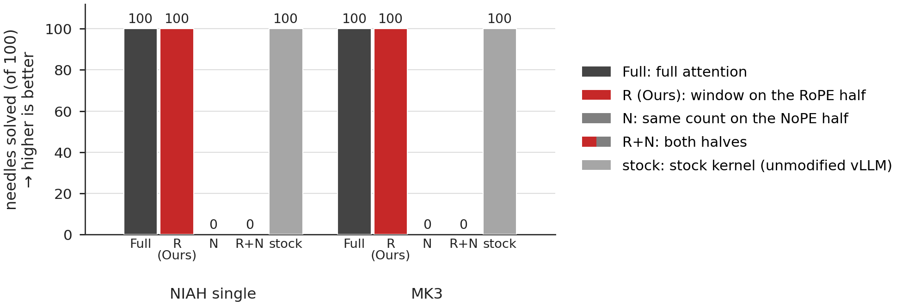
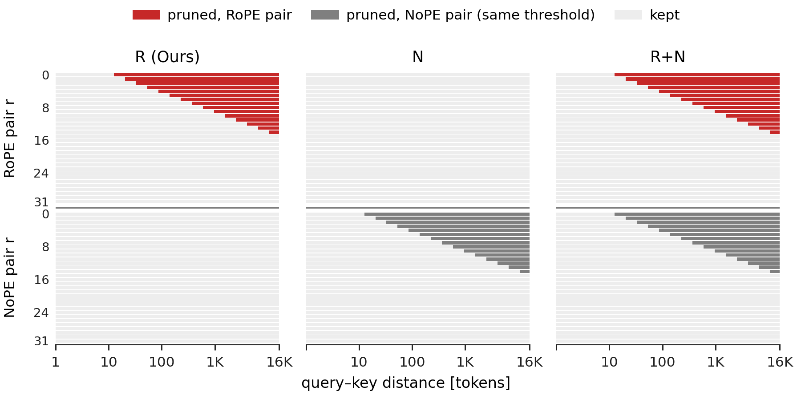

# MiniMax-M2.7: the window on the rotary half versus the other half

**Result.** MiniMax-M2.7 rotates 64 of the 128 dimensions of every attention head. With the window on the rotary half (R), it prunes 16.9–21.4% of all QK terms, which is 33.9–42.8% of the terms in the rotary dimensions, at top-1 agreement 0.873–0.902, close to the 0.896–0.917 of swapping in vLLM's own attention kernel; removing exactly as many terms from the non-rotary half (N) raises PPL by 43–108% and drops top-1 to 0.574–0.670. In greedy RULER generation at 16K, R and the stock kernel solve 100/100 per task with the same right/wrong verdict as Full on every item, while N and R+N solve 0/100.

MiniMax-M2.7 on RULER needles at 16K with generation, full set (100 per task). Bars from 0: needles solved by Full, R (Ours), N, R+N and the stock kernel (unmodified vLLM). R and stock solve 100/100 with the same right/wrong verdict as Full on every item; N and R+N solve 0/100.

What R (Ours), N and R+N prune in one MiniMax-M2.7 head (k = 2). Rows: the 32 RoPE and 32 NoPE dimension pairs; x: query–key distance (log). R prunes RoPE pair r beyond w_r = 2λ_r; N, a count-matched control, prunes NoPE pair r beyond the same w_r.

Setup

- **Conditions** (all compared against Full):
  - **Full:** the same attention path with no window.
  - **R (Ours):** the window on the 32 rotary pairs, `w_r = 2·λ_r`. The shortest rotary pair keeps distances up to 12.6 tokens, and 15 of the 32 rotary pairs reach their threshold within 16K; the same pattern applies to every head and layer.
  - **N:** the same thresholds on the 32 pairs without rotation, mapped one to one, so N removes the same number of products as R at every distance.
  - **R+N:** both.
  - **stock:** the stock kernel (unmodified vLLM; "stock" below), no window. It shows the size of an implementation change.
- **Model:** `MiniMaxAI/MiniMax-M2.7`, revision `0a6536713b0b03f3be97494e5cf8d22f668a3164`, the released FP8 E4M3 weights (128×128 blocks); 62 layers, head dim 128 (rotary dim 64, RoPE base 5·10⁶), window on all layers and heads.
- **Serving:** a vLLM integration that will be released separately; vLLM 0.29.1rc1, tensor parallel 4 on one node with four NVIDIA B200 GPUs (GB200 NVL4); BF16 activations between layers and BF16 KV; prefill chunk 16,384. Full, R, N and R+N run through an eager PyTorch attention path (BF16 Q/K inputs; scores, softmax and PV accumulated in FP32); the stock arm uses vLLM's own kernel.
- **Prose part:** the LongBench-v2 text of `../model_scale/` (SHA-256 `3052e5a1…29e4be`), the first T tokens under the model's tokenizer, no chat template, teacher-forced, one text per length; positions `0 … T−2` are scored. The final-norm hidden states (BF16) are multiplied by the LM head (BF16 weights) in FP64. Mean `KL(P_Full ‖ P_condition)` over positions, top-1 agreement with Full's argmax, and PPL on the text's own next tokens. QK pruned share = removed (query, key, pair) terms ÷ (T(T+1)/2 × 64 pairs); the pruned shares match the closed form in `../partial_rope_qk_closed_form/` to within 3·10⁻⁵.
- **Generation part:** greedy generation, up to 128 new tokens, on two RULER tasks at 16K, all five conditions on every item, 100 items per task. Scores use RULER's `string_match_all`.
- **Verification:** for both parts, the scorer's output and an independent recount from the saved records agree on every reported cell; for the prose part, to a relative difference of at most 4·10⁻¹⁰. For the generation part, all 200 items and their 2,000 primary requests were matched to the original run records, and the check against the stock kernel was confirmed by a second, separate checker.

Numbers

Teacher-forced prose, 8K–32K:

| T | condition | QK pruned | top-1 | mean KL | ΔPPL % |
|---:|:---|---:|---:|---:|---:|
| 8,192 | R (Ours) | 16.93% | 0.9017 | 0.0937 | +0.21 |
| 8,192 | N | 16.93% | 0.6704 | 0.7406 | +42.75 |
| 8,192 | R+N | 33.86% | 0.6650 | 0.7687 | +45.82 |
| 16,384 | R (Ours) | 19.18% | 0.8887 | 0.1279 | −0.41 |
| 16,384 | N | 19.18% | 0.6160 | 1.0484 | +94.19 |
| 16,384 | R+N | 38.35% | 0.5904 | 1.2068 | +129.68 |
| 32,768 | R (Ours) | 21.41% | 0.8726 | 0.1596 | −1.76 |
| 32,768 | N | 21.41% | 0.5739 | 1.2215 | +107.53 |
| 32,768 | R+N | 42.83% | 0.5444 | 1.4287 | +154.76 |

Changes without any window, against Full:

| T | stock kernel: KL / top-1 / ΔPPL % | stock, chunk change: KL / top-1 / ΔPPL % | Full, chunk change: KL / top-1 / ΔPPL % |
|---:|---|---|---|
| 8,192 | 0.0734 / 0.9170 / +0.72 | 0.0685 / 0.9160 / −1.64 | 0.0663 / 0.9144 / +0.67 |
| 16,384 | 0.0858 / 0.9044 / +0.58 | 0.0862 / 0.9067 / +0.90 | 0.0842 / 0.9059 / −0.48 |
| 32,768 | 0.1037 / 0.8955 / +0.15 | 0.1020 / 0.8972 / +1.20 | 0.1009 / 0.8957 / −0.49 |

- The QK pruned column counts the terms of all 64 pairs. R removes terms only in the 32 rotary pairs, so its share of the rotary-dimension terms is twice the column: 33.86%, 38.35% and 42.83% at T = 8,192, 16,384 and 32,768 (the same as the R+N column, which removes as many terms again from the other half).
- The chunk change compares 16,384-token chunks with 4,096 at T = 8,192 (where one 8,192 chunk would be a single pass) and with 8,192 otherwise (`floors.csv`).
- R's mean KL is 1.4–1.6× the KL of changing only the prefill chunk size, and R's ΔPPL (−1.76% to +0.21%) is of the same size as the ΔPPL of that change.
- Repeating Full and stock is bit-identical. In every length, Full stays within twice the KL of the stock kernel's chunk change and within 2 points of its top-1.
- Values are rounded for display; `results.csv` has them at full precision. The left panels of `../../figs/partial_rope_r_vs_n.png` (shown in `../partial_rope/`) plot the prose rows next to SmolLM3-3B and Phi-4-mini.

RULER generation at 16K:

- **R (Ours) and stock** give the same right/wrong verdict as Full on every item (b = c = 0).
- **N and R+N** miss every item that Full solves: exact McNemar p = 1.58·10⁻³⁰, difference −100 points, 95% interval −100 to −92.76.
- **Output length:** Full, R and stock stop after 22–33 tokens. N runs to the 128-token cap on 88/100 (`niah_single_3`) and 100/100 (`niah_multikey_3`) items, and R+N on 68/100 and 92/100.
- **Answer positions:** teacher-forced on the gold answer, R has mean KL 0.00217 / 0.00232 and top-1 0.9872 / 0.9959 (`niah_single_3` / `niah_multikey_3`); stock has 0.00179 / 0.00156 and 0.9897 / 0.9951; N has 3.668 / 3.748 and 0.2917 / 0.2439; R+N has 3.722 / 4.020 and 0.3061 / 0.2253.
- **QK pruned:** R removes 19.0–19.1% of the QK terms in these runs.
- **Check against the stock kernel:** in both tasks, repeated Full and stock runs are bit-identical, and Full stays within twice the KL of the stock kernel's chunk change and within 2 points of its top-1 (`floors_generation_16k.csv`).

Files

Condition codes in the files: `F` = Full, `R` = R (Ours), `N`, `RN` = R+N, `stock`.

| file | contents |
|---|---|
| `results.csv` | Prose part. Per (T, condition F/R/N/RN/stock): mean KL against F, top-1, PPL of F and of the condition, ΔPPL %, QK pruned share. |
| `floors.csv` | Prose part. Per (T, setting): KL, top-1 and ΔPPL % of the chunk-size change for stock and for F, with the two chunk sizes. |
| `results_generation_16k.csv` | Generation part, 100 items per task. Per (task, condition): items, correct, b / c against F, exact McNemar p, difference and interval, gold-position KL and top-1, finish reasons, generated-length range, QK pruned share. |
| `floors_generation_16k.csv` | Generation part. Per task: F against stock (KL, top-1) next to the stock kernel's chunk-size change and the check limits. |

