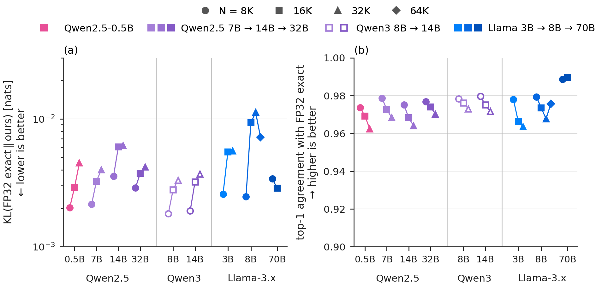

# Fidelity at 7B–70B

**Result.** On Qwen2.5-7B/14B/32B, Qwen3-8B-Base/14B-Base and Llama-3.1-8B/70B at 8K–32K tokens (Llama-3.1-8B also at 64K; Llama-3.1-70B at 8K and 16K), the window with `k = 2` prunes 36.84–48.58% of the QK terms while top-1 agreement with exact attention stays at 0.9640–0.9896, mean KL at 0.00181–0.01122 nats, and |ΔPPL| ≤ 0.21% (range −0.138% to +0.208%).

Fidelity of the window (k = 2) to FP32 exact from 0.5B to 70B parameters (teacher-forced prose, N = 8K–64K). Left: KL (log); right: top-1 agreement (axis from 0.90); marker = N, colour = family (Qwen3 open), darker = larger. Across all 27 points KL stays within 0.0018–0.0112 and top-1 within 0.962–0.990.

The figure also shows Qwen2.5-0.5B and Llama-3.2-3B; their points are the wavelength-order rows of `../window_assignment/`.

Setup

- **Models:** `Qwen/Qwen2.5-7B`, `Qwen/Qwen2.5-14B`, `Qwen/Qwen2.5-32B`, `Qwen/Qwen3-8B-Base`, `Qwen/Qwen3-14B-Base`, `unsloth/Meta-Llama-3.1-8B`, `unsloth/Meta-Llama-3.1-70B` (base models; revisions in `results.csv`). Both Qwen3 checkpoints have RoPE base 10⁶, no RoPE scaling, head dim 128 and a native context of 32,768, so every `N` is within it.
- **Text:** LongBench-v2 `data.json` (revision `2b48e494f2c7a2f0af81aae178e05c7e1dde0fe9`, SHA-256 `15d61c22…7fe2`), the `context` field of six documents joined into one text of 403,319 characters (SHA-256 `3052e5a1…29e4be`); `text_manifest.json` lists the documents, their order, character spans and hashes. The Llama-3.1-8B 64K row uses an extended text of 948,730 characters from 16 LongBench-v2 documents, with the six above as its prefix (`extended_900k` in `../partial_rope/text_manifest.json`).
- **Sequence:** the first `N` tokens of the text under each model's tokenizer, no chat template, one sequence per row, batch 1; every position `0 … N−2` is scored. The Qwen3 tokenizers give the same token ids as Qwen2.5 at every `N` (equal SHA-256 in `results.csv`).
- **Window:** `k = 2` on every layer and head, `w_r = 2·λ_r` with `λ_r = 2π / inv_freq_r` taken from the loaded model's rotary embedding (for Llama 3.1 this includes its `llama3` RoPE scaling). Exact attention is the same harness with the window off.
- **Method:** each row is one teacher-forced pass of the exact model and one of the windowed model over the same `N` tokens. Attention is computed block by block in fp32, and the sequence is processed in 2,048-token chunks. Top-1 agreement over all scored positions, mean `KL(P_exact ‖ P_window)` over the full vocabulary, and PPL on the sequence's own next tokens. QK pruned share is `1 − kept/total`, counting (query, key, pair) terms over the whole causal triangle; it depends only on `N`, the head dimension and the RoPE frequencies, which is why models of one family share it.
- **Qwen3:** Qwen3 normalizes each head's query and key before RoPE. For every Qwen3 row, a recorded check confirms that the query and key the harness windows (after those norms and RoPE) are bit-identical to the ones the model's own attention module computes.
- **Arithmetic:** fp32 weights and activations, TF32 off (recorded per run: both override variables `0`, `matmul.allow_tf32 = False`, `cudnn.allow_tf32 = False`, matmul precision `highest`), no autocast; PyTorch 2.11.0+cu130 (Qwen3 rows: PyTorch 2.11.0 with CUDA 13.2, transformers 4.57.1).
- **Hardware:** NVIDIA H100 (95,830 MiB), driver 615.71.09. 7B/8B (including 64K) on one GPU; 14B and 32B split layer-wise over two GPUs of one node; 70B over four.

Numbers

| model | N | QK pruned | top-1 | mean KL | ΔPPL % |
|---|---:|---:|---:|---:|---:|
| Qwen2.5-7B | 8,192 | 36.84% | 0.9786 | 0.00215 | +0.032 |
| Qwen2.5-7B | 16,384 | 41.85% | 0.9726 | 0.00326 | +0.139 |
| Qwen2.5-7B | 32,768 | 46.86% | 0.9684 | 0.00399 | +0.151 |
| Qwen2.5-14B | 8,192 | 36.84% | 0.9751 | 0.00357 | +0.089 |
| Qwen2.5-14B | 16,384 | 41.85% | 0.9683 | 0.00603 | +0.099 |
| Qwen2.5-14B | 32,768 | 46.86% | 0.9640 | 0.00618 | +0.208 |
| Qwen2.5-32B | 8,192 | 36.84% | 0.9768 | 0.00288 | −0.138 |
| Qwen2.5-32B | 16,384 | 41.85% | 0.9739 | 0.00376 | +0.024 |
| Qwen2.5-32B | 32,768 | 46.86% | 0.9702 | 0.00419 | +0.139 |
| Qwen3-8B-Base | 8,192 | 36.84% | 0.9784 | 0.00181 | −0.045 |
| Qwen3-8B-Base | 16,384 | 41.85% | 0.9761 | 0.00280 | −0.099 |
| Qwen3-8B-Base | 32,768 | 46.86% | 0.9730 | 0.00331 | +0.015 |
| Qwen3-14B-Base | 8,192 | 36.84% | 0.9796 | 0.00191 | −0.064 |
| Qwen3-14B-Base | 16,384 | 41.85% | 0.9751 | 0.00321 | −0.083 |
| Qwen3-14B-Base | 32,768 | 46.86% | 0.9716 | 0.00370 | +0.085 |
| Llama-3.1-8B | 8,192 | 38.47% | 0.9794 | 0.00247 | +0.078 |
| Llama-3.1-8B | 16,384 | 42.53% | 0.9735 | 0.00931 | +0.024 |
| Llama-3.1-8B | 32,768 | 45.83% | 0.9677 | 0.01122 | +0.158 |
| Llama-3.1-8B | 65,536 | 48.58% | 0.9757 | 0.00720 | +0.121 |
| Llama-3.1-70B | 8,192 | 38.47% | 0.9886 | 0.00341 | +0.067 |
| Llama-3.1-70B | 16,384 | 42.53% | 0.9896 | 0.00287 | +0.043 |

- Values are rounded for display; `results.csv` has every value at full precision, together with the model revision, the text, the SHA-256 of the token ids, and PPL for both arms.
- The pruned share grows with length as the closed form predicts; for the Llama-3.1 rows it agrees with the closed-form count of the top-level README's reduction curve to within 6·10⁻⁵.

Files

| file | contents |
|---|---|
| `results.csv` | One row per (model, N): revision, text, token-id SHA-256, QK pruned share, top-1, mean KL, PPL exact / window, ΔPPL %, number of GPUs (21 rows; the six Qwen3 rows are the last). |
| `text_manifest.json` | The six LongBench-v2 documents that make up the text, with character spans and SHA-256 of each context and of the joined text. |

