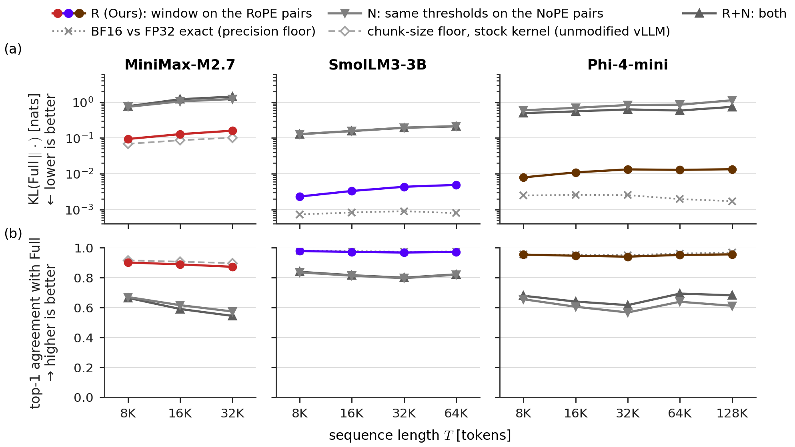

# Window on the rotary part versus the non-rotary part

**Result.** In models that rotate only part of attention, the window belongs on the rotary part. There (R) it prunes 25–41% of the QK terms while top-1 agreement stays at 0.940–0.978 and |ΔPPL| ≤ 0.46%; the same thresholds on the non-rotary part (N) prune only 8–14% of the terms, yet top-1 falls to 0.567–0.835 and PPL rises by 9.8–184%.

R (Ours) vs. N in three partial-RoPE models (k = 2): R in the model colour, N and R+N grey. Top: KL to Full (no window; log); bottom: top-1 agreement with Full; dotted: precision floor; dashed: stock-kernel (unmodified vLLM) chunk-size floor. R keeps top-1 at 0.87–0.98; N, removing no more terms, falls to 0.57–0.84.

The middle and right panels are this study (SmolLM3-3B, with 9 of 36 layers without RoPE, and Phi-4-mini-instruct, with 96 of 128 head dimensions rotary). The left panel is MiniMax-M2.7 from `../minimax_m27_partial_rope/`. The window rule never prunes pairs without rotation; the closed-form pruned share of partial-RoPE layouts is in `../partial_rope_qk_closed_form/`.

Setup

- **Models:** `HuggingFaceTB/SmolLM3-3B` (revision `a07cc9a04f16550a088caea529712d1d335b0ac1`): 36 layers; layers 3, 7, …, 35 apply no RoPE; RoPE base 5,000,000. `microsoft/Phi-4-mini-instruct` (revision `cfbefacb99257ffa30c83adab238a50856ac3083`): 32 layers; dimensions 0–95 of each 128-dimensional head are rotary (48 pairs), 96–127 are not (16 pairs); RoPE base 10,000 with its LongRoPE long factors, which apply at every length measured here.
- **Conditions:**
  - **Full:** no window.
  - **R:** the window on the rotary part only — the 27 RoPE layers of SmolLM3, the 48 rotary pairs of Phi-4-mini.
  - **N:** the same thresholds on the non-rotary part only — on the 9 NoPE layers of SmolLM3, pair `r` gets the RoPE ladder's `w_r`; on Phi-4-mini, non-rotary pair `s` (dimensions `96+s`, `112+s`) gets `w_{3s+1}`, so the 16 pairs span the 48-rung ladder.
  - **R+N:** both.
- **Window:** `k = 2`, `w_r = min(2·λ_r, T)` with `λ_r = 2π / inv_freq_r` from the loaded model.
- **Text:** LongBench-v2 `data.json` (revision `2b48e494f2c7a2f0af81aae178e05c7e1dde0fe9`), `context` field. `base` (403,319 characters, 6 documents; the same text as `../model_scale/`) for T ≤ 32,768, and `extended_900k` (948,730 characters, 16 documents, `base` plus further documents appended) for T = 65,536 and 131,072. The first T tokens under the model's tokenizer, no chat template, batch 1; positions `0 … T−2` are scored.
- **QK pruned share:** the denominator is always every (query, key, pair) term of all 64 pairs, all heads and all layers over the causal triangle. On SmolLM3 the per-layer pruned share is the same in R and N, so the whole-model share of N is one third of R's (9 against 27 layers); on Phi-4-mini, N prunes within 16 pairs and R within 48. In both models N removes fewer terms than R and still moves the output much further from Full.
- **Arithmetic:** fp32, TF32 off (recorded per run), eager attention; PyTorch 2.11.0+cu128, transformers 4.57.1. The BF16 comparison casts the model to BF16 (rotary buffers kept in FP32) and compares against the saved FP32 run. An independent recomputation from the saved per-position values reproduces top-1 agreement exactly, and PPL to within 5 float32 ULP (ΔPPL within 7·10⁻⁵ percentage points).
- **Hardware:** NVIDIA RTX PRO 6000 Blackwell Workstation Edition (97,887 MiB), driver 595.84.

Numbers

SmolLM3-3B (9 of 36 layers without RoPE):

| T | condition | QK pruned | top-1 | mean KL | ΔPPL % |
|---:|:---|---:|---:|---:|---:|
| 8,192 | R | 24.81% | 0.9783 | 0.00232 | −0.077 |
| 8,192 | N | 8.27% | 0.8354 | 0.1284 | +9.82 |
| 8,192 | R+N | 33.08% | 0.8391 | 0.1274 | +9.66 |
| 16,384 | R | 28.18% | 0.9720 | 0.00330 | −0.008 |
| 16,384 | N | 9.39% | 0.8130 | 0.1566 | +12.52 |
| 16,384 | R+N | 37.57% | 0.8162 | 0.1558 | +12.41 |
| 32,768 | R | 31.54% | 0.9680 | 0.00433 | +0.127 |
| 32,768 | N | 10.51% | 0.7965 | 0.1941 | +16.00 |
| 32,768 | R+N | 42.06% | 0.7996 | 0.1927 | +15.86 |
| 65,536 | R | 34.91% | 0.9719 | 0.00488 | +0.098 |
| 65,536 | N | 11.64% | 0.8196 | 0.2145 | +19.72 |
| 65,536 | R+N | 46.55% | 0.8223 | 0.2107 | +19.27 |

Phi-4-mini-instruct (96 of 128 head dimensions rotary):

| T | condition | QK pruned | top-1 | mean KL | ΔPPL % |
|---:|:---|---:|---:|---:|---:|
| 8,192 | R | 26.41% | 0.9545 | 0.00793 | −0.457 |
| 8,192 | N | 8.82% | 0.6557 | 0.5932 | +62.29 |
| 8,192 | R+N | 35.23% | 0.6788 | 0.4935 | +46.89 |
| 16,384 | R | 29.97% | 0.9465 | 0.01093 | −0.235 |
| 16,384 | N | 10.00% | 0.6054 | 0.6947 | +78.98 |
| 16,384 | R+N | 39.98% | 0.6402 | 0.5539 | +57.42 |
| 32,768 | R | 33.54% | 0.9403 | 0.01325 | −0.155 |
| 32,768 | N | 11.17% | 0.5672 | 0.8332 | +103.88 |
| 32,768 | R+N | 44.70% | 0.6163 | 0.6284 | +68.32 |
| 65,536 | R | 37.10% | 0.9522 | 0.01285 | −0.258 |
| 65,536 | N | 12.35% | 0.6388 | 0.8470 | +112.85 |
| 65,536 | R+N | 49.45% | 0.6934 | 0.5846 | +65.21 |
| 131,072 | R | 40.67% | 0.9557 | 0.01339 | −0.423 |
| 131,072 | N | 13.57% | 0.6118 | 1.1291 | +183.78 |
| 131,072 | R+N | 54.24% | 0.6820 | 0.7389 | +92.63 |

- Values are rounded for display; `results.csv` has every value at full precision (including the Full rows: no window, KL 0, top-1 1).
- For scale, running the same model in BF16 without any window, against the FP32 run, gives mean KL 0.00073–0.00090 and top-1 0.973–0.980 on SmolLM3, and 0.00172–0.00258 and 0.951–0.969 on Phi-4-mini (`floors.csv`). R stays within one order of magnitude of these values; N is two orders of magnitude above them.

Files

Condition codes in the files: `F` = Full, `R`, `N`, `RN` = R+N.

| file | contents |
|---|---|
| `results.csv` | One row per (model, T, condition F/R/N/RN): revision, text variant, token-id SHA-256, k, mean KL, top-1, PPL full / condition, ΔPPL %, QK pruned share. |
| `floors.csv` | One row per (model, T): BF16 versus FP32, no window. |
| `text_manifest.json` | The documents of the `base` and `extended_900k` texts, with character spans and SHA-256 values. |

