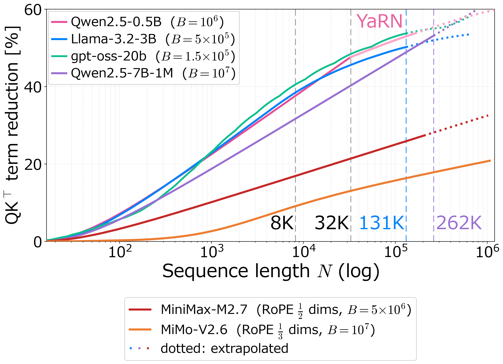

# How much a partial-RoPE model prunes: the closed form

**Result.** In models that rotate only part of attention, the share of QK⊤ terms the window removes is a closed form of the configuration and needs no weights: at `k = 2` it reaches 16.93–32.65% for MiniMax-M2.7, 9.13–20.82% for MiMo-V2.6 (all 70 layers) and 24.81–48.39% for SmolLM3-3B from N = 8,192 to 1,048,576 tokens, and agrees with the exact counts of the measured runs to within 3·10⁻⁵.

Share of QK⊤ terms removed by the window (k = 2, prefill) against N, in closed form, with two partial-RoPE models added to the four models of the top-level README's reduction curve (NoPE pairs are never removed). Dotted: extrapolated beyond the native context.

As with RoPE on every dimension, the share grows logarithmically with `N`; a model's rotary fraction scales it, because pairs without rotation call for a different technique and are outside the scope of this window rule; the shares here are those of the window rule alone. The four upper curves are the reduction curves of the top-level README, drawn with the same functions; the gpt-oss-20b curve (12 full-attention and 12 sliding-window layers, YaRN) gives 40.55% at 8K, 51.26% at 64K and 53.75% at 128K.

Setup

- **Count:** prefill over the full causal triangle, `k = 2`, counted per dimension pair over every attention layer; pairs without rotation and layers without the window count at full size. `qk_reduction_partial_rope.py` computes it from `atflash/window_table.py`.
- **Layouts:**

| model | attention layout used here |
|---|---|
| MiniMax-M2.7 | 62 full-attention layers; head dim 128 = 32 rotary pairs (rotary dim 64, RoPE base 5·10⁶) + 32 pairs without rotation. |
| MiMo-V2.6-Pro-RL | 70 layers = 10 full-attention layers (query/key head dim 192 = 32 rotary pairs, RoPE base 10⁷, + 64 pairs without rotation) + 60 sliding-window layers (window 128). The window is applied to the 10 full-attention layers; the sliding-window layers keep their own window and are counted unchanged. The column "10 full-attention layers" restricts the count to those layers, the convention of `../mimo_v26_longbench_v2/`. |
| SmolLM3-3B | 36 layers, head dim 128 = 64 rotary pairs (RoPE base 5·10⁶); every fourth layer (9 of 36) applies no RoPE. |

- **Running it:**

      python evaluations/partial_rope_qk_closed_form/qk_reduction_partial_rope.py results.csv

  It needs only PyTorch (for `atflash.window_table`) and prints the table below. `tools/cpu_checks.py` reruns it and checks that the CSV it writes is byte-identical to `results.csv`.

Numbers

| N | MiniMax-M2.7 | MiMo-V2.6, all 70 layers | MiMo-V2.6, 10 full-attention layers | SmolLM3-3B |
|---:|---:|---:|---:|---:|
| 8,192 | 16.93% | 9.13% | 10.83% | 24.81% |
| 16,384 | 19.18% | 11.21% | 12.25% | 28.18% |
| 32,768 | 21.42% | 13.08% | 13.69% | 31.54% |
| 65,536 | 23.67% | 14.77% | 15.12% | 34.91% |
| 131,072 | 25.91% | 16.36% | 16.55% | 38.28% |
| 262,144 | 28.16% | 17.89% | 17.99% | 41.65% |
| 524,288 | 30.40% | 19.36% | 19.42% | 45.02% |
| 1,048,576 | 32.65% | 20.82% | 20.85% | 48.39% |

- The values are arithmetic on the configuration; a row does not mean that the model runs at that length (MiniMax-M2.7's native context, for example, is 204,800 tokens, where the same closed form gives 27.35%). `results.csv` holds the same values at full precision.
- The measured runs count kept terms exactly, query by query, and agree with this closed form to within 3·10⁻⁵:
  - MiniMax-M2.7 at 8K / 16K / 32K: measured 0.169288 / 0.191768 / 0.214145 (`../minimax_m27_partial_rope/results.csv`, condition R);
  - SmolLM3-3B at 8K–64K: measured 0.248110 / 0.281759 / 0.315432 / 0.349115 (`../partial_rope/results.csv`, condition R).
- The MiMo study reports 12.20% / 13.61% / 15.05% / 16.42% of the 192-dimension terms of the full-attention layers in its 16K / 32K / 64K / 128K bands. Those are sums over items of different lengths within each band, so they sit near, not on, the single-length column above.

Files

| file | contents |
|---|---|
| `qk_reduction_partial_rope.py` | Computes the table; with an output path it also writes the CSV. |
| `results.csv` | One row per N: the pruned share of each column above, at full precision. |

