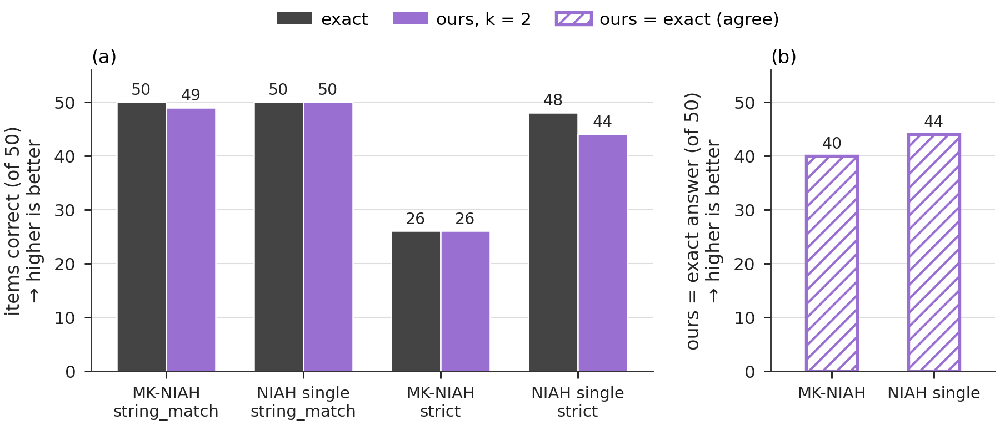

# Needle retrieval at 128K

**Result.** On 100 RULER needle items at about 131K tokens (Qwen2.5-7B-Instruct-1M), the windowed model contains the correct 7-digit value in 99/100 answers with `k = 2` and in 100/100 with `k = 64` under RULER's `string_match` metric; exact attention scores 100/100.

RULER needle retrieval at 128K (Qwen2.5-7B-Instruct-1M, teacher-forced). Left: items correct for exact (dark gray) and ours (k = 2, purple); right: items where ours gives exactly the answer tokens of exact. With string_match, ours retrieves 99/100 and exact 100/100.

Setup

- **Model:** `Qwen/Qwen2.5-7B-Instruct-1M`, revision `e28526f7bb80e2a9c8af03b831a9af3812f18fba`, standard RoPE path (base 10⁷, no YaRN).
- **Tasks:** RULER `niah_multikey_1` generator, unchanged (4 adjective–noun keys, 7-digit values, 40-point depth grid), and `niah_single` = the same generator with one key, following RULER's `niah_single_2`. 50 trials each (trials 0–49), each seeded from `20260612`, the task name and the trial number.
- **Haystack:** LongBench-v2 prose (`data.json`, SHA-256 `15d61c22…7fe2`) in place of RULER's default essays.
- **Length:** prompt 130,132–131,064 tokens (`mk_niah`) and 131,054–131,063 (`niah_single`); prompt + gold ≤ 131,072. No chat template.
- **Arms:** exact (the window wider than the sequence, no pruning) and window, `w_r = min(k·λ_r, L)` with `k = 2`, and in a second run `k = 64`. In each run, exact and window are computed for every item in the same eager PyTorch harness, attention computed block by block. The `k = 64` run repeated the exact arm on the same 100 items; its predictions are identical to those of the `k = 2` run on every item.
- **Scoring (teacher-forced answers):** the gold answer (8 tokens: a space and 7 digits) is appended to the prompt and the model reads the whole sequence once; the prediction at each answer position is the argmax given the gold tokens before it.
  - `string_match`: RULER's official metric (case-insensitive substring match of the reference value in the decoded prediction), applied to that prediction.
  - agrees with exact: the window arm's 8 predicted tokens equal the exact arm's.
  - `strict`: all 8 predicted tokens equal the gold tokens, separator included.
  - `match_frac`: the fraction of the 8 answer tokens predicted correctly.
- **Arithmetic and hardware:** fp32 weights, activations and K/V, TF32 off (recorded per run); PyTorch 2.11.0+cu128, transformers 4.57.1; NVIDIA RTX PRO 6000 Blackwell Workstation Edition (97,887 MiB), driver 595.84.

Numbers

`string_match` and agreement with exact are the primary metrics; `strict` and `match_frac` are reported alongside.

| task | arm | n | string_match | agrees with exact | strict | mean match_frac |
|---|---|---:|---:|---:|---:|---:|
| `mk_niah` (4 keys, 1 queried) | exact | 50 | 50/50 | — | 26/50 | 0.94 |
| `mk_niah` | window, `k = 2` | 50 | 49/50 | 40/50 | 26/50 | 0.9375 |
| `mk_niah` | window, `k = 64` | 50 | 50/50 | 44/50 | 22/50 | 0.93 |
| `niah_single` (1 key) | exact | 50 | 50/50 | — | 48/50 | 0.995 |
| `niah_single` | window, `k = 2` | 50 | 50/50 | 44/50 | 44/50 | 0.985 |
| `niah_single` | window, `k = 64` | 50 | 50/50 | 46/50 | 44/50 | 0.985 |
| total | exact | 100 | 100/100 | — | 74/100 | 0.9675 |
| total | window, `k = 2` | 100 | 99/100 | 84/100 | 70/100 | 0.96125 |
| total | window, `k = 64` | 100 | 100/100 | 90/100 | 66/100 | 0.9575 |

- With `k = 2`, 15 of the 16 items whose answer tokens differ from exact differ only in the first answer token, a space or a colon before identical digits; this separator is why `strict` is lower for both arms. The remaining item (`mk_niah`, trial 22) has one different digit in the window arm (`":4037232"` against the gold `" 7037232"`).
- With `k = 64`, all 10 items whose answer tokens differ from exact differ only in that separator, with identical digits; trial 22 is answered with the correct digits.

Files

| file | contents |
|---|---|
| `results.csv` | `k = 2`: the per-task sums behind the table. |
| `items.csv` | `k = 2`: one row per item: task, trial, prompt length, gold text, both arms' predicted text, `string_match`, `strict`, token agreement, and the fraction of answer tokens matched (`match_frac`). |
| `results_k64.csv` | `k = 64`: the per-task sums, same columns as `results.csv`. |
| `items_k64.csv` | `k = 64`: one row per item, same columns as `items.csv`. |

