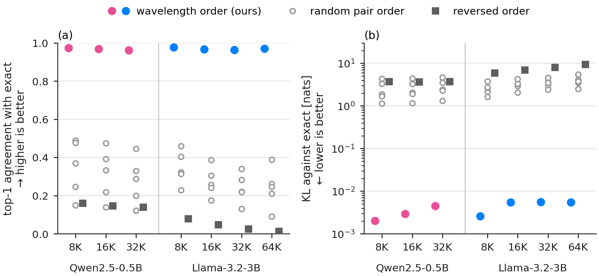

# Which pairs get which widths: the wavelength assignment

**Result.** The fidelity comes from giving each frequency pair the width of its own wavelength, `w_r = k·λ_r`. With the same number of kept pairs at every query–key distance, the wavelength order keeps top-1 agreement with exact attention at 0.962–0.978, while the reversed order gives 0.013–0.160 and five random orders give 0.090–0.489.

Equal term count, different assignment of the per-pair windows (Qwen2.5-0.5B and Llama-3.2-3B). Left: top-1 agreement with exact; right: KL (log). Filled circles: wavelength order (ours), in the model colour; grey: random pair order (open) and reversed order (squares). Only the wavelength order stays close to exact (top-1 0.962–0.978).

An input-dependent assignment that hands the longest windows to the pairs with the largest measured contribution `|X_r|` on the same text reaches 0.919–0.960, below the input-independent rule. Pruning that ignores distance stays far from exact: a fixed set of pairs removed at every distance gives 0.001–0.171 at the same total budget, and removing one eighth of the pairs at every distance (12.5% of the terms) gives 0.012–0.589.

Setup

- **Models:** `Qwen/Qwen2.5-0.5B` (revision `060db6499f32faf8b98477b0a26969ef7d8b9987`, head dim 64) and `unsloth/Llama-3.2-3B` (revision `d4446454d87d51aa42e1fb174f25acc5f8762331`, head dim 128, `llama3` RoPE scaling with factor 32).
- **Text:** the LongBench-v2 text of `../model_scale/` (first `N` tokens; the token-id hashes in `results.csv` equal those of the same tokenizer there). The 64K Llama rows use the extended text: LongBench-v2 contexts appended to at least 900,000 characters, with the prefix preserved.
- **Arms:**
  - **wavelength order:** `w_r = 2·λ_r` (the rule).
  - **reversed / random:** the same widths permuted over the pairs (reversed order, or five seeded random permutations), so the kept count at every distance is identical by construction.
  - **magnitude-ranked:** widths ranked by each pair's mean `|X_r|` from `../dropped_vs_kept_terms/` on the same text, once for the whole model (global) or per layer and head.
  - **distance-independent:** a fixed pair set removed at all distances; either the lowest-frequency pairs, with two set sizes bracketing the rule's total count, or five random sets of the closer size.
  - **one band:** one of eight equal frequency bands removed at all distances.
- **Measurement:** teacher-forced exact and windowed passes over the same tokens, fp32 with TF32 off (recorded per run), eager attention computed block by block in 2,048-token chunks. Top-1 agreement, mean `KL(P_exact ‖ P_window)` and PPL are taken over all positions, as in `../model_scale/`.
- **Hardware:** NVIDIA GH200 (97,871 MiB), PyTorch 2.11.0a0 (NVIDIA container 26.03).

Numbers

Same kept count at every distance, top-1 agreement with exact attention:

| model | N | wavelength order | reversed | random (5 seeds) | magnitude-ranked (global / per head) |
|---|---:|---:|---:|---:|---:|
| Qwen2.5-0.5B | 8,192 | 0.9736 | 0.1601 | 0.1493–0.4887 | — |
| Qwen2.5-0.5B | 16,384 | 0.9692 | 0.1466 | 0.1390–0.4743 | — |
| Qwen2.5-0.5B | 32,768 | 0.9624 | 0.1392 | 0.1215–0.4463 | 0.9551 / 0.9604 |
| Llama-3.2-3B | 8,192 | 0.9779 | 0.0787 | 0.2296–0.4590 | — |
| Llama-3.2-3B | 16,384 | 0.9664 | 0.0482 | 0.1755–0.3867 | — |
| Llama-3.2-3B | 32,768 | 0.9636 | 0.0249 | 0.1307–0.3397 | 0.9317 / 0.9191 |
| Llama-3.2-3B | 65,536 | 0.9703 | 0.0129 | 0.0900–0.3890 | — |

- In every row the arms prune exactly the same terms per distance (37.6–48.1% of the QK terms, depending on model and `N`).
- The wavelength order has mean KL 0.0020–0.0056 and ΔPPL −0.21% to +0.25%; the reversed and random orders have mean KL 1.1–9.4 nats and PPL increases of 216% up to more than 10⁶%.

Distance-independent pruning at 32K:

| model | arm | QK pruned | top-1 |
|---|---|---:|---:|
| Qwen2.5-0.5B | lowest-frequency pairs removed (set size low / high) | 46.87% / 50.00% | 0.1016 / 0.1021 |
| Qwen2.5-0.5B | random pair sets (5 seeds) | 46.87% | 0.0273–0.1078 |
| Qwen2.5-0.5B | one band of 1/8 of the pairs removed (8 bands) | 12.50% | 0.0469–0.4847 |
| Llama-3.2-3B | lowest-frequency pairs removed (set size low / high) | 45.31% / 46.87% | 0.0010 / 0.0052 |
| Llama-3.2-3B | random pair sets (5 seeds) | 45.31% | 0.0696–0.1706 |
| Llama-3.2-3B | one band of 1/8 of the pairs removed (8 bands) | 12.50% | 0.0122–0.5890 |

These arms drop their pairs at every distance except the query's own position; their budget is matched in total (the two set sizes sit on either side of the rule's count) or, for the bands, set far below it.

Files

| file | contents |
|---|---|
| `results.csv` | One row per (model, N, arm): revision, token-id SHA-256, whether the kept count matches the rule at every distance, QK pruned share, top-1, mean KL, PPL exact / window, ΔPPL %. |

